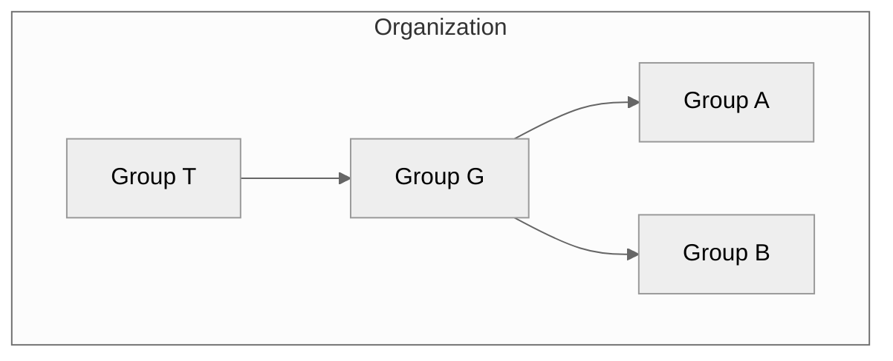



- Édition : Gratuite, GitLab Premium, GitLab Ultimate
- Offre : GitLab.com, GitLab Self-Managed, GitLab Dedicated



Dans GitLab, vous utilisez des groupes pour gérer un ou plusieurs projets associés en même temps.

Vous pouvez utiliser des groupes pour communiquer avec tous les membres du groupe et gérer les permissions pour vos projets. Si une personne a accès au groupe, elle obtient l'accès à tous les projets du groupe.

Vous pouvez également consulter tous les tickets et les merge requests des projets du groupe, ainsi que les analyses sur l'activité du groupe.

Pour les organisations de grande taille, vous pouvez également créer des [sous-groupes](subgroups/_index.md).

Pour plus d'informations sur la création et la gestion de vos groupes, consultez [Gérer les groupes](manage.md).

## Hiérarchie des groupes {#group-hierarchy}

Les groupes sont organisés en arborescence :

- Un **groupe principal** est un groupe créé à la « racine » de l'organisation. Une organisation peut avoir un ou plusieurs groupes principaux. Un groupe principal peut contenir un ou plusieurs sous-groupes.
- Un **groupe parent** est un groupe qui contient un ou plusieurs sous-groupes.
- Un **sous-groupe** est un groupe qui fait partie d'un autre groupe.

Par exemple, dans le diagramme suivant :

- L'organisation comporte quatre groupes : un groupe principal (T), qui contient un sous-groupe (G), et deux sous-groupes dans G (A et B).
- T est un groupe principal et le groupe parent de G.
- G est un sous-groupe (enfant) de T et le groupe parent de A et B.
- A et B sont des sous-groupes (enfants) de G.

## Structure des groupes {#group-structure}

La manière de configurer un groupe dépend de vos cas d'utilisation, de la taille de votre équipe et de vos exigences en matière d'accès. Le tableau suivant décrit les modèles les plus courants de structuration des groupes.

<!-- vale gitlab_base.Simplicity = NO -->

| Modèle | Structure | Cas d'utilisation |
| ----- | --------- | --------- |
| Simple | Un groupe pour tous vos projets. | Travaillez au sein d'une petite équipe ou sur des solutions spécifiques (par exemple, un site web marketing) nécessitant une collaboration fluide et un accès aux ressources. |
| Équipe | Différents groupes ou sous-groupes pour différents types d'équipes (par exemple, produit et ingénierie). | Travaillez au sein d'une grande organisation où certaines équipes fonctionnent de manière autonome ou nécessitent des ressources centralisées et un accès limité de la part des membres d'équipes externes. |
| Client | Un groupe pour chaque client. | Fournissez des solutions personnalisées à plusieurs clients nécessitant des ressources et des niveaux d'accès différents. |
| Fonctionnalité | Un groupe ou sous-groupe pour un type de fonctionnalité (par exemple, IA/ML). | Développez des produits complexes où une fonctionnalité nécessite des ressources spécifiques et la collaboration d'experts en la matière. |

<!-- vale gitlab_base.Simplicity = YES -->

> [!note]
> Sur GitLab Self-Managed, si vous souhaitez voir une vue d'ensemble de toute votre organisation, vous devez créer un groupe principal. Pour plus d'informations sur les efforts visant à créer une vue organisationnelle de tous les groupes, [voir l'epic 9266](https://gitlab.com/groups/gitlab-org/-/work_items/9266). Un groupe principal offre des informations sur l'ensemble de votre organisation grâce à un [tableau de bord et centre de sécurité](../application_security/security_dashboard/_index.md), un [rapport sur les vulnérabilités](../application_security/vulnerability_report/_index.md), un [centre de conformité](../compliance/compliance_center/_index.md) et des [analyses de flux de valeur](value_stream_analytics/_index.md) complets.

### Limites recommandées pour la structure des groupes {#recommended-limits-for-group-structure}

Les groupes n'ont pas de limites imposées concernant l'appartenance, la profondeur de la hiérarchie ou le nombre de partages de groupes. Cependant, des structures volumineuses ou profondément imbriquées peuvent dégrader les performances. Les tableaux de bord peuvent se charger lentement, les calculs de permissions peuvent expirer et certaines opérations peuvent renvoyer des erreurs `500`. Pour maintenir un groupe réactif, restez dans les limites recommandées suivantes :

| Structure | Limite recommandée | Limite maximale | Symptôme probable au-delà de la limite recommandée |
| --------- | ----------------- | ------------- | ------------------------------------------- |
| Membres par groupe | Moins de 1 000 | Aucune | Les performances se dégradent. À partir de 1 500 membres ou plus, les opérations peuvent expirer ou renvoyer des erreurs `500`. |
| Groupes enfants par groupe parent | Moins de 100 | Aucune | La navigation et les calculs de permissions ralentissent. |
| Profondeur de la hiérarchie | Cinq niveaux ou moins | 20 niveaux | Les requêtes de base de données peuvent expirer. |

Les limites recommandées diffèrent des limites maximales. Une limite maximale est un plafond technique imposé par GitLab. Si un groupe dépasse une limite recommandée, il est toujours pris en charge.

Les problèmes de performances sont les plus graves lorsque ces limites se combinent. Par exemple, un groupe qui présente à la fois un imbrication profonde et de nombreux groupes enfants peut provoquer des délais d'expiration des requêtes de base de données plus tôt que l'une ou l'autre condition seule.

Les limites recommandées reflètent le comportement de performance actuel. Pour plus d'informations sur les travaux planifiés pour vous aider à passer d'une structure volumineuse et profondément imbriquée à une structure plus performante, consultez [l'epic 21582](https://gitlab.com/groups/gitlab-org/-/epics/21582).

#### Rester dans les limites recommandées {#stay-within-the-recommended-limits}

Si un groupe approche ou dépasse les limites recommandées, vous pouvez utiliser les solutions de contournement suivantes pour réduire l'impact sur les performances.

Pour les groupes avec un grand nombre de membres :

- Divisez un groupe qui compte plus de 1 000 membres en groupes fonctionnels plus petits, chacun avec 500 membres ou moins. Par exemple, remplacez un groupe unique regroupant tous les ingénieurs par des groupes distincts pour les ingénieurs frontend, backend et infrastructure.
- Partagez chaque groupe plus petit individuellement avec des projets et des groupes, plutôt que de partager un grand groupe.
- Pour les modifications en masse des membres, utilisez l'[API des membres de groupe](../../api/group_members.md) avec des délais entre les requêtes afin de respecter les [limites de débit de gestion des membres](../../administration/instance_limits.md#rate-limits).

Pour les hiérarchies profondes ou larges :

- Limitez les hiérarchies à cinq niveaux ou moins.
- Utilisez des groupes principaux distincts pour les parties de votre organisation qui n'ont pas besoin de partager l'appartenance héritée, plutôt que d'imbriquer tout sous une seule hiérarchie.
- Réduisez le nombre de groupes enfants directs sous un seul groupe parent.

Pour les partages de groupes :

- Ajoutez un groupe directement à un projet au lieu de le partager via des partages de groupes imbriqués lorsque vous devez gérer les permissions individuelles des membres.
- Si un nouveau sous-groupe n'hérite pas des permissions d'un groupe partagé, modifiez le rôle du partage pour une valeur différente, puis revenez à la valeur précédente pour déclencher un recalcul des permissions.
- Lorsque vous effectuez de nombreuses opérations de partage de groupe en une seule fois, comme des opérations en masse ou une automatisation, exécutez-les une à la fois ou avec une simultanéité limitée plutôt que toutes en parallèle. De nombreuses opérations de partage simultanées sur un groupe avec un grand nombre de membres peuvent créer des contentions de base de données et dégrader la réactivité de l'instance.
- Attendez-vous à ce que l'accès provenant d'un partage de groupe à groupe (imbriqué) prenne plus de temps à se propager qu'un partage de projet direct, car il est appliqué sous forme de mise à jour par lots différée.

Pour les hiérarchies volumineuses synchronisées depuis un fournisseur d'identité :

- Configurez les intervalles de [synchronisation LDAP](../../administration/auth/ldap/ldap_synchronization.md) pour éviter la limitation de débit sur le fournisseur d'identité. Des erreurs de limite de débit lors d'une synchronisation peuvent bloquer des utilisateurs ou supprimer des appartenances à des groupes.

## Visibilité des groupes {#group-visibility}

Comme les projets, un groupe peut être configuré pour être visible par :

- Les utilisateurs anonymes.
- Tous les utilisateurs authentifiés.
- Uniquement les membres explicites du groupe.

La restriction relative aux [niveaux de visibilité](../../administration/settings/visibility_and_access_controls.md#restrict-visibility-levels) au niveau des paramètres de l'application s'applique également aux groupes. Si défini sur interne, la page d'exploration est vide pour les utilisateurs anonymes. La page du groupe affiche une icône de niveau de visibilité.

Les utilisateurs ne peuvent pas créer un sous-groupe ou un projet avec un niveau de visibilité supérieur à celui du groupe parent immédiat.

## Explorer les groupes {#explore-groups}

Pour explorer tous les groupes publics ou internes :

1. Dans la barre supérieure, sélectionnez **Rechercher ou accéder à**.
1. Dans la liste déroulante, sélectionnez **Explorer**.
1. Dans la barre latérale gauche, sélectionnez **Groupes**.

## Voir les groupes dont vous êtes membre {#view-groups-you-are-a-member-of}



- L'onglet **Membre** a été [introduit](https://gitlab.com/groups/gitlab-org/-/work_items/13781) dans GitLab 18.2 [avec un feature flag](../../administration/feature_flags/_index.md) nommé `your_work_groups_vue`. Fonctionnalité désactivée par défaut.
- [Disponibilité générale](https://gitlab.com/gitlab-org/gitlab/-/issues/542790) dans GitLab 18.3. Suppression du feature flag `your_work_groups_vue`.



Pour afficher les groupes dont vous êtes membre direct ou indirect :

1. Dans la barre supérieure, sélectionnez **Rechercher ou accéder à**.
1. Dans la liste déroulante, sélectionnez **Voir tous mes groupes**.

Cette page affiche les groupes dont vous êtes membre via :

- L'appartenance au groupe parent d'un sous-groupe.
- L'appartenance directe ou héritée à un projet dans le groupe ou le sous-groupe.

### Voir les groupes inactifs {#view-inactive-groups}



- [Introduction](https://gitlab.com/groups/gitlab-org/-/work_items/13781) de l'onglet **Inactif** dans GitLab 18.2 [avec un feature flag](../../administration/feature_flags/_index.md) nommé `your_work_groups_vue`. Fonctionnalité désactivée par défaut.
- [Disponibilité générale](https://gitlab.com/gitlab-org/gitlab/-/issues/542790) dans GitLab 18.3. Suppression du feature flag `your_work_groups_vue`.
- [Introduction](https://gitlab.com/groups/gitlab-org/-/work_items/13781) de l'onglet **Inactif** sur la page **Explorer les groupes** dans GitLab 18.8 [avec un feature flag](../../administration/feature_flags/_index.md) nommé `explore_groups_vue`. Fonctionnalité désactivée par défaut.
- [Passage en disponibilité générale](https://gitlab.com/gitlab-org/gitlab/-/issues/585432) dans GitLab 18.11. Suppression du feature flag `explore_groups_vue`.



Un groupe est inactif lorsqu'il est en attente de suppression ou qu'il a été archivé.

Pour afficher tous les groupes inactifs :

1. Dans la barre supérieure, sélectionnez **Rechercher ou accéder à**.
1. Dans la liste déroulante, sélectionnez l'une des options suivantes :
   - **Voir tous mes groupes** pour filtrer les groupes dont vous êtes membre.
   - **Explorer** pour filtrer les groupes publics ou internes.
1. Sélectionnez l'onglet **Inactif**.

Chaque groupe inactif dans la liste affiche un badge indiquant que le groupe est archivé ou en attente de suppression.

Si le groupe est en attente de suppression, la liste affiche également :

- La date à laquelle la suppression définitive du groupe est planifiée.
- Une action **Restaurer**. Lorsque vous restaurez un groupe :
  - Le label **Suppression en attente** est supprimé. Le groupe n'est plus planifié pour la suppression.
  - Le groupe est retiré de l'onglet **Inactif**.

## Voir un groupe {#view-a-group}



- L'accès au groupe avec l'identifiant du groupe a été [introduit](https://gitlab.com/gitlab-org/gitlab/-/merge_requests/165889) dans GitLab 17.5.



La page de présentation du groupe affiche des informations sur le groupe et ses membres, sous-groupes et projets, notamment :

- Description du groupe
- Activité récente
- Nombre de merge requests et de tickets créés
- Nombre de membres ajoutés
- Sous-groupes et projets
- Projets partagés
- Projets archivés

Pour voir un groupe :

- Dans la barre supérieure, sélectionnez **Rechercher ou accéder à**, puis recherchez votre groupe.

Vous pouvez rechercher les sous-groupes et les projets du groupe et les trier par ordre croissant ou décroissant.

Vous pouvez accéder à un groupe en utilisant son identifiant plutôt que son nom à l'adresse `https://gitlab.example.com/-/g/<id>`. Par exemple, si votre groupe `example-group` a l'identifiant `123456`, vous pouvez accéder au groupe à l'adresse `https://gitlab.example.com/example-group` ou `https://gitlab.example.com/-/g/123456`.

## Trouver l'identifiant du groupe {#find-the-group-id}

Vous pourriez avoir besoin de l'identifiant du groupe si vous souhaitez interagir avec lui en utilisant l'[API GitLab](../../api/_index.md).

Pour trouver l'identifiant du groupe :

1. Dans la barre supérieure, sélectionnez **Rechercher ou accéder à**, puis recherchez votre groupe.
1. Sur la page de présentation du groupe, dans le coin supérieur droit, sélectionnez **Actions** ().
1. Sélectionnez **Copier l'identifiant du groupe**.

## Voir l'activité du groupe {#view-group-activity}

Pour voir l'activité d'un groupe :

1. Dans la barre supérieure, sélectionnez **Rechercher ou accéder à**, puis recherchez votre groupe.
1. Dans la barre latérale gauche, sélectionnez **Gérer** > **Activité**.
1. Facultatif. Pour filtrer l'activité par type de contribution, sélectionnez un onglet :

   - **Tous** : toutes les contributions des membres du groupe dans le groupe et les projets du groupe.
   - **Événements poussés** : événements push dans les projets du groupe.
   - **Événements de fusion** : les merge requests acceptées dans les projets du groupe.
   - **Événements liés à un ticket** : tickets ouverts et fermés dans les projets du groupe.
   - **Commentaires** : commentaires publiés par les membres du groupe dans les projets du groupe.
   - **Wiki** : mises à jour des pages wiki dans le groupe.
   - **Designs** : Designs ajoutés, mis à jour et supprimés dans les projets du groupe.
   - **Équipe** : membres du groupe qui ont rejoint et quitté les projets du groupe.

## Créer un groupe {#create-a-group}

Pour créer un groupe :

<!-- vale gitlab_base.FutureTense = NO -->

1. Dans le coin supérieur droit, sélectionnez **Créer un nouveau** () et **Nouveau groupe**.
1. Sélectionnez **Créer un groupe**.
1. Dans la zone de texte **Nom du groupe**, saisissez le nom du groupe. Pour obtenir une liste des mots ne pouvant pas être utilisés comme noms de groupe, consultez [les noms réservés](../reserved_names.md).
1. Dans la zone de texte **URL du groupe**, saisissez le chemin du groupe utilisé pour l'[espace de nommage](../namespace/_index.md).
1. Sélectionnez le [**Niveau de visibilité**](../public_access.md) du groupe.
1. Facultatif. Pour personnaliser votre expérience GitLab :
   - Pour **Qui utilisera ce groupe ?**, sélectionnez une option.
   - Dans la liste déroulante **À quoi vous servira ce groupe ?**, sélectionnez une option.
1. Facultatif. Pour inviter des membres dans le groupe, dans la zone de texte **E-mail 1**, saisissez l'adresse e-mail de l'utilisateur que vous souhaitez inviter. Pour inviter d'autres utilisateurs, sélectionnez **Inviter un autre membre** et saisissez l'adresse e-mail de l'utilisateur.
1. Sélectionnez **Créer un groupe**.

<!-- vale gitlab_base.FutureTense = YES -->

<i class="fa-youtube-play" aria-hidden="true"></i> Pour plus d'informations sur les groupes, regardez [GitLab Namespaces (utilisateurs, groupes et sous-groupes)](https://youtu.be/r0sJgjR2f5A).

## Modifier le nom, la description et l'avatar du groupe {#edit-group-name-description-and-avatar}

Vous pouvez modifier les détails de votre groupe depuis les paramètres généraux du groupe.

Prérequis :

- Vous devez avoir le rôle Propriétaire pour le groupe.

Pour modifier les détails du groupe :

1. Dans la barre supérieure, sélectionnez **Rechercher ou accéder à**, puis recherchez votre groupe.
1. Dans la barre latérale gauche, sélectionnez **Paramètres** > **Généralités**.
1. Dans la zone de texte **Nom du groupe**, saisissez le nom de votre groupe. Consultez les [limitations sur les noms de groupe](../reserved_names.md).
1. Facultatif. Dans la zone de texte **Description du groupe (optionnel)**, saisissez la description de votre groupe. La description est limitée à 500 caractères.
1. Facultatif. Sous **Avatar de groupe**, sélectionnez **Choisir un fichier**, puis sélectionnez une image. La taille d'image idéale est de 192 x 192 pixels et la taille de fichier maximale autorisée est de 200 Ko.
1. Sélectionnez **Enregistrer les modifications**.

## Quitter un groupe {#leave-a-group}

Lorsque vous quittez un groupe :

- Vous n'êtes plus membre du groupe, de ses sous-groupes et de ses projets, et ne pouvez plus contribuer.
- Tous les tickets et les merge requests qui vous étaient assignés sont désassignés.

Pour quitter un groupe :

1. Dans la barre supérieure, sélectionnez **Rechercher ou accéder à**, puis recherchez votre groupe.
1. Sur la page de présentation du groupe, dans le coin supérieur droit, sélectionnez **Actions** ().
1. Sélectionnez **Quitter le groupe**, puis **Quitter le groupe** à nouveau.

## Planifier la suppression d'un groupe {#schedule-a-group-for-deletion}



- [Déplacé](https://gitlab.com/groups/gitlab-org/-/work_items/17208) de GitLab Premium vers GitLab Free dans GitLab 18.0.



Par défaut, lorsque vous supprimez un groupe pour la première fois, il entre dans un état de suppression en attente. Supprimez à nouveau le groupe pour le supprimer immédiatement.

Prérequis :

- Vous devez disposer du rôle Propriétaire pour le groupe.
- Si un groupe contient des projets, les propriétaires doivent être [autorisés à supprimer des projets](../../administration/settings/visibility_and_access_controls.md#restrict-project-deletion-to-administrators).

Pour supprimer un groupe et son contenu :

1. Dans la barre supérieure, sélectionnez **Rechercher ou accéder à**, puis recherchez votre groupe.
1. Sur la page de présentation du groupe, dans le coin supérieur droit, sélectionnez **Actions** ().
1. Sélectionnez **Supprimer**.
1. Dans la boîte de dialogue de confirmation, saisissez le chemin du groupe et sélectionnez **Oui, supprimer le groupe**.

Vous pouvez également supprimer un groupe depuis le tableau de bord des groupes :

1. Dans la barre supérieure, sélectionnez **Rechercher ou accéder à** > **Voir tous mes groupes**.
1. Sélectionnez () pour le groupe que vous souhaitez supprimer.
1. Sélectionnez **Supprimer**.
1. Dans la boîte de dialogue de confirmation, saisissez le chemin du groupe et sélectionnez **Oui, supprimer le groupe**.

Cette action ajoute un job en arrière-plan pour planifier la suppression d'un groupe. Sur GitLab.com, le groupe est supprimé après 30 jours. Sur GitLab Self-Managed, vous pouvez modifier la période de rétention via les [paramètres de l'instance](../../administration/settings/visibility_and_access_controls.md#deletion-protection).

Lorsqu'un groupe est planifié pour la suppression, les pipelines CI/CD planifiés cessent de s'exécuter.

Si l'utilisateur ayant planifié la suppression du groupe perd l'accès au groupe (par exemple, en quittant le groupe, en voyant son rôle rétrogradé ou en étant banni du groupe) avant que la suppression n'ait lieu, le job de suppression restaure le groupe à la place, et le groupe n'est plus planifié pour la suppression.

> [!warning]
> Si l'utilisateur ayant planifié la suppression du groupe récupère le rôle Propriétaire ou l'accès administrateur avant l'exécution du job, le job supprime définitivement le groupe.

## Supprimer immédiatement un groupe {#delete-a-group-immediately}



- [Déplacé](https://gitlab.com/groups/gitlab-org/-/work_items/17208) de GitLab Premium vers GitLab Free dans GitLab 18.0.



Si vous ne souhaitez pas attendre, vous pouvez supprimer un groupe immédiatement.

Prérequis :

- Vous devez disposer du rôle Propriétaire pour le groupe.
- Vous avez [planifié la suppression du groupe](#schedule-a-group-for-deletion).

Pour supprimer définitivement un groupe planifié pour la suppression :

1. Dans la barre supérieure, sélectionnez **Rechercher ou accéder à**, puis recherchez votre groupe.
1. Sur la page de présentation du groupe, dans le coin supérieur droit, sélectionnez **Actions** ().
1. Sélectionnez **Supprimer définitivement**.
1. Dans la boîte de dialogue de confirmation, saisissez le chemin du groupe et sélectionnez **Oui, supprimer le groupe**.

Cette action supprime le groupe, ses sous-groupes, ses projets et toutes les ressources associées, y compris les tickets et les merge requests.

## Restaurer un groupe {#restore-a-group}

Pour restaurer un groupe planifié pour la suppression :

1. Dans la barre supérieure, sélectionnez **Rechercher ou accéder à**, puis recherchez votre groupe.
1. Sur la page de présentation du groupe, dans le coin supérieur droit, sélectionnez **Actions** ().
1. Sélectionnez **Restaurer**.

## Gérer les groupes avec le menu Actions {#manage-groups-with-the-actions-menu}

Vous pouvez afficher une liste de tous vos groupes et les gérer avec le menu **Actions**.

Prérequis :

- Toutes les actions disponibles, sauf quitter un groupe, nécessitent le rôle Propriétaire.

Pour accéder au menu **Actions** pour les groupes :

1. Dans la barre supérieure, sélectionnez **Rechercher ou accéder à** > **Voir tous mes groupes**.
1. Sur la page **Groupes**, trouvez votre groupe et sélectionnez le menu **Actions** ().
1. Sélectionnez une action.

Les actions suivantes sont disponibles, selon l'état du groupe :

| État du groupe      | Actions disponibles       |
| ---------------- | ----------------------- |
| Actif           | **Modifier**, **Archiver**, **Transférer**, **Quitter le groupe**, **Supprimer** |
| Archivé         | **Désarchiver**, **Quitter le groupe**, **Supprimer** |
| Suppression en attente | **Restaurer**, **Quitter le groupe** |

## Demander l'accès à un groupe {#request-access-to-a-group}

En tant qu'utilisateur, vous pouvez demander à devenir membre d'un groupe, si un administrateur l'autorise.

1. Dans la barre supérieure, sélectionnez **Rechercher ou accéder à** > **Voir tous mes groupes**.
1. En haut à droite, sélectionnez **Explorer les groupes**.
1. Dans la zone de texte **Rechercher**, saisissez le nom du groupe que vous souhaitez rejoindre.
1. Dans les résultats de recherche, sélectionnez le nom du groupe.
1. Sur la page du groupe, sous le nom du groupe, sélectionnez **Demander l'accès**.

Jusqu'à dix des propriétaires du groupe les plus récemment actifs reçoivent un e-mail avec votre demande. N'importe quel propriétaire du groupe peut approuver ou refuser la demande.

Si vous changez d'avis avant l'approbation de votre demande, sélectionnez **Supprimer la demande d'accès**.

## Voir les membres du groupe {#view-group-members}

Pour voir les membres d'un groupe :

1. Dans la barre supérieure, sélectionnez **Rechercher ou accéder à**, puis recherchez votre groupe.
1. Dans la barre latérale gauche, sélectionnez **Gérer** > **Membres**.

Un tableau affiche les informations suivantes du membre :

- Nom et nom d'utilisateur du **Compte**.
- **Source** de leur [appartenance](../project/members/_index.md#membership-types). Les membres du groupe ayant plusieurs sources apparaissent deux fois dans le tableau **Membres** et sont comptés comme des membres distincts. Les membres du groupe ayant des rôles élevés, comme Propriétaire ou Responsable de maintenance, remplacent les rôles moins restrictifs dans les groupes et projets descendants. Par exemple, un membre du groupe avec le rôle Propriétaire peut être directement assigné au rôle Développeur dans un sous-groupe ou un projet descendant. Cependant, comme le membre est également assigné au rôle Propriétaire, il dispose des permissions propres au Propriétaire. [Le ticket 502458](https://gitlab.com/gitlab-org/gitlab/-/work_items/502458) propose une modification de ce comportement où la source d'un membre affiche le rôle effectif le plus élevé.
- [**Rôle**](../project/members/_index.md#which-roles-you-can-assign) dans le groupe.
- Date d'**Expiration** de leur appartenance au groupe.
- **Activité** liée à leur compte.

Pour voir tous les membres de l'espace de nommage (et leurs sièges respectifs occupés), dans le groupe principal, [consultez la page **Quotas d'utilisation**](../../subscriptions/manage_seats.md#view-seat-usage).

## Filtrer et trier les membres d'un groupe {#filter-and-sort-members-in-a-group}

Pour trouver des membres dans un groupe, vous pouvez trier, filtrer ou rechercher.

### Filtrer un groupe {#filter-a-group}

Filtrez un groupe pour trouver des membres. Par défaut, tous les membres du groupe et des sous-groupes sont affichés.

Dans les listes de membres du groupe, les entrées peuvent afficher les badges suivants :

- **SAML**, pour indiquer que le membre dispose d'un [compte SAML](saml_sso/_index.md) qui lui est associé.
- **Enterprise**, pour indiquer que le membre du groupe principal est un [utilisateur d'entreprise](../enterprise_user/_index.md).

1. Dans la barre supérieure, sélectionnez **Rechercher ou accéder à**, puis recherchez votre groupe.
1. Dans la barre latérale gauche, sélectionnez **Gérer** > **Membres**.
1. Au-dessus de la liste des membres, dans la zone de texte **Filtrer les membres**, saisissez vos critères de recherche. Pour afficher :
   - Les membres directs du groupe, sélectionnez **Appartenance = Direct**.
   - Les membres hérités, partagés et partagés hérités du groupe, sélectionnez **Appartenance = Indirect**.
   - Les membres avec l'authentification à deux facteurs activée ou désactivée, sélectionnez **2FA = Activée** ou **2FA = Désactivée**.
   - Les membres du groupe principal qui sont des [utilisateurs d'entreprise](../enterprise_user/_index.md), sélectionnez **Entreprise = vrai**.

### Rechercher dans un groupe {#search-a-group}

Vous pouvez rechercher des membres par nom, nom d'utilisateur ou [adresse e-mail publique](../profile/_index.md#set-your-public-email).

1. Dans la barre supérieure, sélectionnez **Rechercher ou accéder à**, puis recherchez votre groupe.
1. Dans la barre latérale gauche, sélectionnez **Gérer** > **Membres**.
1. Au-dessus de la liste des membres, dans la zone **Filtrer les membres**, saisissez les critères de recherche.
1. À droite de la zone **Filtrer les membres**, sélectionnez la loupe ().

### Trier les membres d'un groupe {#sort-members-in-a-group}

Vous pouvez trier les membres par **Compte**, **Accès autorisé**, **Rôle** ou **Dernière connexion**.

1. Dans la barre supérieure, sélectionnez **Rechercher ou accéder à**, puis recherchez votre groupe.
1. Dans la barre latérale gauche, sélectionnez **Gérer** > **Membres**.
1. Au-dessus de la liste des membres, dans le coin supérieur droit, dans la liste **Compte**, sélectionnez les critères de filtrage.
1. Pour basculer le tri entre croissant et décroissant, à droite de la liste **Compte**, sélectionnez la flèche ( ou ).

## Ajouter des utilisateurs à un groupe {#add-users-to-a-group}



- La date d'expiration d'accès pour les membres directs des sous-groupes et des projets a été [supprimée](https://gitlab.com/gitlab-org/gitlab/-/issues/471051) dans GitLab 17.4.



Vous pouvez donner à un utilisateur l'accès à tous les projets d'un groupe.

Prérequis :

- Vous devez avoir le rôle Propriétaire pour le groupe.
- Pour les instances GitLab Self-Managed :
  - Si [la création de nouveaux comptes utilisateurs est désactivée](../../administration/settings/sign_up_restrictions.md#disable-new-user-account-creation), un administrateur doit ajouter l'utilisateur.
  - Si [les invitations d'utilisateurs ne sont pas autorisées](../../administration/settings/visibility_and_access_controls.md#prevent-invitations-to-groups-and-projects), un administrateur doit ajouter l'utilisateur.
  - Si [l'approbation de l'administrateur est activée](../../administration/settings/sign_up_restrictions.md#turn-on-administrator-approval-for-role-promotions), un administrateur doit approuver l'invitation.

1. Dans la barre supérieure, sélectionnez **Rechercher ou accéder à**, puis recherchez votre groupe.
1. Dans la barre latérale gauche, sélectionnez **Gérer** > **Membres**.
1. Sélectionnez **Inviter des membres**.
1. Si l'utilisateur :

   - Possède un compte GitLab, saisissez le nom d'utilisateur de l'utilisateur.
   - Ne possède pas de compte GitLab, saisissez l'adresse e-mail de l'utilisateur.

1. Sélectionnez un [rôle par défaut](../permissions.md) ou un [rôle personnalisé](../custom_roles/_index.md).
1. Facultatif. Pour la **Date d’expiration de l’accès**, saisissez ou sélectionnez une date. À partir de cette date, l'utilisateur ne peut plus accéder au projet.

   Si vous saisissez une date d'expiration d'accès, le membre du groupe reçoit une notification par e-mail sept jours avant l'expiration de son accès.

   > [!warning]
   > Les responsables de maintenance disposent de toutes les permissions jusqu'à l'expiration de leur rôle, y compris la possibilité de prolonger leur propre date d'expiration d'accès.

1. Sélectionnez **Inviter**. Si vous invitez l'utilisateur par son :

   - Nom d'utilisateur GitLab, l'utilisateur est ajouté à la liste des membres.
   - Adresse e-mail, l'utilisateur reçoit une invitation par e-mail et est invité à créer un compte. Si l'invitation n'est pas acceptée, GitLab envoie des e-mails de rappel deux, cinq et dix jours plus tard. Les invitations non acceptées sont automatiquement supprimées après 90 jours.

Les membres qui ne sont pas ajoutés automatiquement sont affichés dans l'onglet **Invité**. Cet onglet inclut les utilisateurs qui :

- N'ont pas encore accepté l'invitation.
- Attendent [l'approbation d'un administrateur](../../administration/moderate_users.md).
- Dépassent le plafond d'utilisateurs du groupe.

### Voir les utilisateurs en attente de promotion {#view-users-pending-promotion}

Si [l'approbation de l'administrateur pour les promotions de rôles](../../administration/settings/sign_up_restrictions.md#turn-on-administrator-approval-for-role-promotions) est activée, les demandes d'appartenance qui font passer des utilisateurs existants à un rôle facturable nécessitent l'approbation d'un administrateur.

Pour voir les utilisateurs en attente de promotion :

1. Dans la barre supérieure, sélectionnez **Rechercher ou accéder à**, puis recherchez votre groupe.
1. Dans la barre latérale gauche, sélectionnez **Gérer** > **Membres**.
1. Sélectionnez l'onglet **Promotions de rôle**.

Si l'onglet **Promotions de rôle** n'est pas affiché, le groupe n'a aucune promotion en attente.

## Supprimer un membre du groupe {#remove-a-member-from-the-group}

Prérequis :

- Vous devez avoir le rôle Propriétaire.
- Le membre doit avoir une appartenance directe au groupe. Si l'appartenance est héritée d'un groupe parent, le membre ne peut être supprimé que du groupe parent.

Pour supprimer un membre d'un groupe :

1. Dans la barre supérieure, sélectionnez **Rechercher ou accéder à**, puis recherchez votre groupe.
1. Dans la barre latérale gauche, sélectionnez **Gérer** > **Membres**.
1. À côté du membre que vous souhaitez supprimer, sélectionnez l'ellipse verticale ().
1. Sélectionnez **Supprimer le membre**.
1. Facultatif. Dans la boîte de dialogue de confirmation **Supprimer le membre**, cochez une ou les deux cases à cocher :
   - **Supprimer également l'appartenance des utilisateurs directs des projets et sous-groupes**
   - **Désassigner également cet utilisateur des tickets liés et des merge requests**
1. Sélectionnez **Supprimer le membre**.

Les administrateurs GitLab peuvent également [s'assurer que les utilisateurs supprimés ne peuvent pas se réinviter](../project/members/_index.md#ensure-removed-users-cannot-invite-themselves-back).

## Ajouter des projets à un groupe {#add-projects-to-a-group}

Vous pouvez ajouter un nouveau projet à un groupe de deux manières :

- Sélectionnez un groupe, puis sélectionnez **Nouveau projet**. Vous pouvez ensuite continuer à [créer votre projet](../project/_index.md).
- Lors de la création d'un projet, sélectionnez un groupe dans la liste déroulante.

  

### Spécifier qui peut ajouter des projets à un groupe {#specify-who-can-add-projects-to-a-group}

Par défaut, les utilisateurs disposant au minimum du rôle :

- Développeur peuvent créer des projets sous un groupe. Cette valeur par défaut peut être modifiée.
- Responsable de maintenance peuvent dupliquer des projets dans un groupe. Cette valeur par défaut empêche les utilisateurs disposant du rôle Développeur de dupliquer des projets contenant des branches protégées et ne peut pas être modifiée.

Pour spécifier quels rôles peuvent créer des projets dans un groupe :

1. Dans la barre supérieure, sélectionnez **Rechercher ou accéder à**, puis recherchez votre groupe.
1. Dans la barre latérale gauche, sélectionnez **Paramètres** > **Généralités**.
1. Développez la section **Permissions et fonctionnalités du groupe**.
1. Dans **Rôle minimal requis pour créer des projets**, sélectionnez une option.
1. Sélectionnez **Enregistrer les modifications**.

Pour plus d'informations sur la modification de ce paramètre à l'échelle globale, consultez [le rôle minimal par défaut requis pour créer des projets](../../administration/settings/visibility_and_access_controls.md#define-which-roles-can-create-projects).
