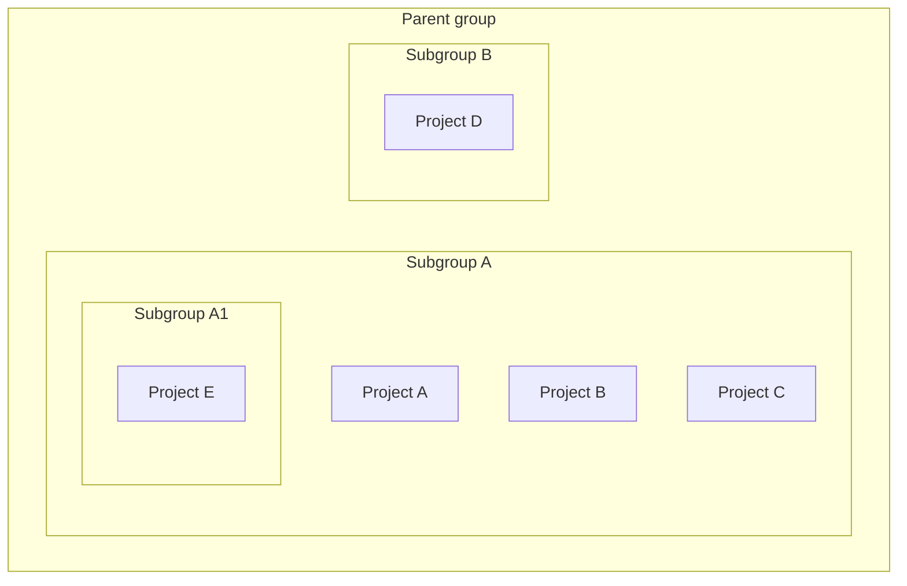
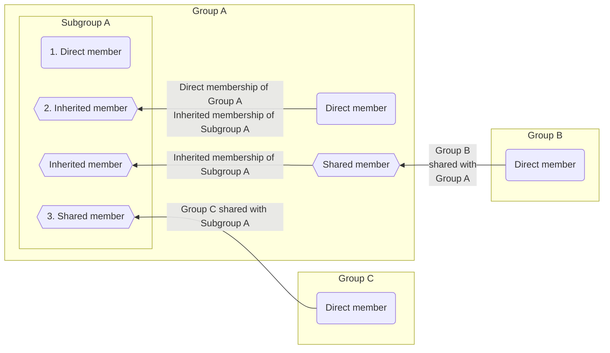



- Édition : Gratuite, GitLab Premium, GitLab Ultimate
- Offre : GitLab.com, GitLab Self-Managed, GitLab Dedicated



Vous pouvez organiser les [groupes](../_index.md) GitLab en sous-groupes. Vous pouvez utiliser les sous-groupes pour :

- Séparer le contenu interne et externe. Chaque sous-groupe pouvant avoir son propre [niveau de visibilité](../../public_access.md), vous pouvez héberger des groupes à des fins différentes sous le même groupe parent.
- Organiser les grands projets. Vous pouvez utiliser les sous-groupes pour gérer qui peut accéder à certaines parties du code source.
- Gérer les permissions. Attribuez à un utilisateur un [rôle](../../permissions.md#group-permissions) différent pour chaque groupe dont il est [membre](#subgroup-membership).

Les sous-groupes peuvent :

- Appartenir à un seul groupe parent direct.
- Avoir plusieurs sous-groupes.
- Être imbriqués jusqu'à 20 niveaux. Pour éviter les problèmes de performance, imbriquez les groupes à cinq niveaux maximum. Pour plus d'informations, consultez les [limites recommandées pour la structure de groupe](../_index.md#recommended-limits-for-group-structure).
- Utiliser des [runners](../../../ci/runners/_index.md) enregistrés auprès des groupes parents :
  - Les secrets configurés pour le groupe parent sont disponibles pour les jobs des sous-groupes.
  - Les utilisateurs disposant du rôle Maintainer ou Owner dans des projets appartenant à des sous-groupes peuvent consulter les détails des runners enregistrés auprès des groupes parents.

Par exemple :

## Afficher les sous-groupes d'un groupe {#view-subgroups-of-a-group}

Prérequis :

- Pour afficher les sous-groupes privés imbriqués, vous devez être un membre direct ou hérité du sous-groupe privé.

Pour afficher les sous-groupes d'un groupe :

1. Dans la barre supérieure, sélectionnez **Rechercher ou accéder à**, puis recherchez votre groupe.
1. Dans la barre latérale gauche, sélectionnez l'onglet **Sous‐groupes et projets**.
1. Sélectionnez le sous-groupe que vous souhaitez afficher. Pour afficher les sous-groupes imbriqués, développez () un sous-groupe.

### Sous-groupes privés dans des groupes parents publics {#private-subgroups-in-public-parent-groups}

Dans la liste hiérarchique, les groupes publics contenant des sous-groupes privés disposent d'une option de développement (), qui indique que le groupe possède des sous-groupes imbriqués. Tous les utilisateurs peuvent voir l'option de développement (), mais seuls les membres directs ou hérités du sous-groupe privé peuvent afficher le groupe privé.

Si vous préférez garder privées les informations relatives à la présence de sous-groupes imbriqués, vous devez ajouter des sous-groupes privés uniquement à des groupes parents privés.

## Créer un sous-groupe {#create-a-subgroup}

Prérequis :

- Vous devez disposer de l'un des éléments suivants :
  - Le rôle Maintainer ou Owner pour un groupe.
  - Le [rôle déterminé par un paramètre](#change-who-can-create-subgroups). Ces utilisateurs peuvent créer des sous-groupes même si la création de groupes est [désactivée par un administrateur](../../../administration/admin_area.md#prevent-a-user-from-creating-top-level-groups) dans les paramètres de l'utilisateur.

> [!note]
> Vous ne pouvez pas héberger un site web de sous-groupe GitLab Pages avec un nom de domaine de premier niveau. Par exemple, `subgroupname.example.io`.

Pour créer un sous-groupe :

1. Dans la barre supérieure, sélectionnez **Rechercher ou accéder à** et trouvez le groupe dans lequel vous souhaitez créer le sous-groupe.
1. Sur la page de présentation du groupe parent, dans le coin supérieur droit, sélectionnez **Nouveau sous-groupe**.
1. Renseignez les champs. Consultez la liste des [noms réservés](../../reserved_names.md) qui ne peuvent pas être utilisés comme noms de groupe.
1. Sélectionnez **Créer un sous-groupe**.

### Modifier qui peut créer des sous-groupes {#change-who-can-create-subgroups}

Prérequis :

- Vous devez disposer du rôle Maintainer ou Owner sur le groupe, selon le paramètre du groupe.

Pour modifier qui peut créer des sous-groupes dans un groupe :

- En tant qu'utilisateur disposant du rôle Owner sur le groupe :
  1. Dans la barre supérieure, sélectionnez **Rechercher ou accéder à**, puis recherchez votre groupe.
  1. Sélectionnez **Paramètres** > **Généralités**.
  1. Développez **Permissions et fonctionnalités du groupe**.
  1. Dans **Rôles autorisés à créer des sous-groupes**, sélectionnez une option.
  1. Sélectionnez **Enregistrer les modifications**.
- En tant qu'administrateur :
  1. Dans le coin supérieur droit, sélectionnez **Admin**.
  1. Dans la barre latérale gauche, sélectionnez **Vue d'ensemble** > **Groupes** et trouvez votre groupe.
  1. Dans la ligne du groupe, sélectionnez **Modifier**.
  1. Dans la liste déroulante **Autorisé à créer des sous-groupes**, sélectionnez une option.
  1. Sélectionnez **Enregistrer les modifications**.

Pour plus d'informations, consultez le [tableau des permissions](../../permissions.md#group-permissions).

## Appartenance aux sous-groupes {#subgroup-membership}



- [Modification](https://gitlab.com/gitlab-org/gitlab/-/issues/219230) : affichage des membres de groupes invités dans l'onglet Membres de la page Membres dans GitLab 16.10 [avec un feature flag](../../../administration/feature_flags/_index.md) nommé `webui_members_inherited_users`. Désactivé par défaut. Fonctionnalité désactivée par défaut.
- [Activé sur GitLab.com et GitLab Self-Managed](https://gitlab.com/gitlab-org/gitlab/-/issues/219230) dans GitLab 17.0.
- [Suppression](https://gitlab.com/gitlab-org/gitlab/-/merge_requests/163627) du feature flag `webui_members_inherited_users` dans GitLab 17.4. Les membres des groupes invités sont affichés par défaut.



Lorsque vous ajoutez un membre à un groupe, ce membre est également ajouté à tous les sous-groupes de ce groupe. Les permissions du membre sont héritées du groupe vers tous les sous-groupes.

Les membres d'un sous-groupe peuvent être :

1. [Membres directs](../../project/members/_index.md#add-users-to-a-project) du sous-groupe.
1. [Membres hérités](../../project/members/_index.md) du sous-groupe provenant du groupe parent du sous-groupe.
1. Membres d'un groupe qui a été [partagé avec le groupe principal du sous-groupe](../../project/members/sharing_projects_groups.md#invite-a-group-to-a-group).
1. Les [membres indirects](../../project/members/_index.md) comprennent les membres hérités et les membres d'un groupe qui a été [invité dans le sous-groupe ou ses ancêtres](../../project/members/sharing_projects_groups.md#invite-a-group-to-a-group).

Les permissions de groupe d'un membre ne peuvent être modifiées que par :

- Les utilisateurs disposant du rôle Owner sur le groupe.
- La modification de la configuration du groupe auquel le membre a été ajouté.

### Déterminer l'héritage de l'appartenance {#determine-membership-inheritance}

Pour vérifier si un membre a hérité des permissions d'un groupe parent :

1. Dans la barre supérieure, sélectionnez **Rechercher ou accéder à**, puis recherchez votre groupe.
1. Dans la barre latérale gauche, sélectionnez **Gérer** > **Membres**. L'héritage du membre est affiché dans la colonne **Source**.

Liste des membres pour un exemple de sous-groupe **Four** :

Dans la capture d'écran précédente :

- Cinq membres ont accès au groupe **Four**.
- L'utilisateur 0 dispose du rôle Reporter sur le groupe **Four** et a hérité ses permissions du groupe **One** :
  - L'utilisateur 0 est un membre direct du groupe **One**.
  - Le groupe **One** se trouve au-dessus du groupe **Four** dans la hiérarchie.
- L'utilisateur 1 dispose du rôle Developer sur le groupe **Four** et a hérité ses permissions du groupe **Two** :
  - L'utilisateur 1 est un membre direct du groupe **Two**, qui est un sous-groupe du groupe **One**.
  - Les groupes **One** / **Two** se trouvent au-dessus du groupe **Four** dans la hiérarchie.
- L'utilisateur 2 dispose du rôle Developer sur le groupe **Four** et a hérité ses permissions du groupe **Three** :
  - L'utilisateur 2 est un membre direct du groupe **Three**, qui est un sous-groupe du groupe **Two**. Le groupe **Two** est un sous-groupe du groupe **One**.
  - Les groupes **One** / **Two** / **Three** se trouvent au-dessus du groupe **Four** dans la hiérarchie.
- L'utilisateur 3 est un membre direct du groupe **Four**. Cela signifie qu'il obtient son rôle Maintainer directement du groupe **Four**.
- L'administrateur dispose du rôle Owner sur le groupe **Four** et est membre de tous les sous-groupes. Pour cette raison, comme pour l'utilisateur 3, la colonne **Source** indique qu'il s'agit d'un membre direct.

Les membres peuvent être [filtrés par appartenance héritée ou directe](../_index.md#filter-a-group).

### Remplacer l'appartenance au groupe ancêtre {#override-ancestor-group-membership}

Les utilisateurs disposant du rôle Owner dans un sous-groupe peuvent y ajouter des membres.

Vous ne pouvez pas attribuer à un utilisateur un rôle dans un sous-groupe inférieur aux rôles qu'il possède dans les groupes parents. Pour remplacer le rôle d'un utilisateur dans un groupe parent, ajoutez l'utilisateur à nouveau dans le sous-groupe avec un rôle supérieur. Par exemple :

- Si l'utilisateur 1 est ajouté au groupe **Two** avec le rôle Developer, l'utilisateur 1 hérite de ce rôle dans chaque sous-groupe du groupe **Two**.
- Pour attribuer le rôle Maintainer à l'utilisateur 1 dans le groupe **Four** (sous **One / Two / Three**), ajoutez à nouveau l'utilisateur 1 au groupe **Four** avec le rôle Maintainer.
- Si l'utilisateur 1 est retiré du groupe **Four**, le rôle de l'utilisateur revient à son rôle dans le groupe **Two**. L'utilisateur 1 retrouve le rôle Developer dans le groupe **Four**.

## Mentionner des sous-groupes {#mention-subgroups}

La mention de sous-groupes ([`@<subgroup_name>`](../../discussions/_index.md#mentions)) dans les epics, les tickets, les commits et les merge requests notifie tous les membres directs de ce groupe. Les membres hérités d'un sous-groupe ne sont pas notifiés par les mentions. Les mentions fonctionnent de la même manière que pour les projets et les groupes, et vous pouvez choisir le groupe de membres à notifier.
