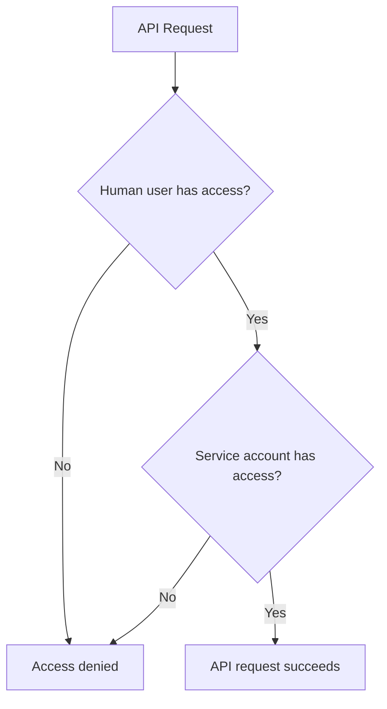



- 티어: Ultimate
- 추가 기능: GitLab Duo with Amazon Q
- 제공 서비스: GitLab Self-Managed





- GitLab 17.7에서 [베타](../../policy/development_stages_support.md#beta)로 도입되었으며, [기능 플래그](../../administration/feature_flags/_index.md) `amazon_q_integration`로 이름이 지정되었습니다. 기본적으로 비활성화되었습니다.
- `amazon_q_integration` 기능 플래그가 GitLab 17.8에서 제거되었습니다.
- GitLab 17.11에서 추가 GitLab Duo 기능 지원과 함께 일반적으로 사용 가능합니다.



> [!note]
> GitLab Duo with Amazon Q는 다른 GitLab Duo 추가 기능과 결합할 수 없습니다.

re:Invent 2024에서 Amazon이 GitLab Duo with Amazon Q 통합을 발표했습니다. 이 통합을 사용하면 작업을 자동화하고 생산성을 높일 수 있습니다.

GitLab Duo with Amazon Q:

- 이슈 및 머지 리퀘스트에서 다양한 작업을 수행할 수 있습니다.
- [다른 많은 GitLab Duo 기능을 포함합니다](../gitlab_duo/feature_summary.md).

클릭 실행 데모를 보려면 [GitLab Duo with Amazon Q 제품 투어](https://gitlab.navattic.com/duo-with-q)를 참고하세요.
<!-- Demo published on 2025-04-23 -->

GitLab Duo with Amazon Q 구독을 받으려면 담당 Account Executive에 문의하세요.

또는 평가판을 요청하려면 [이 양식을 작성](https://about.gitlab.com/partners/technology-partners/aws/#form)하세요.

## GitLab Duo with Amazon Q 설정 {#set-up-gitlab-duo-with-amazon-q}

GitLab Duo with Amazon Q 구독이 있고 GitLab 17.11 이상을 사용하는 경우 [인스턴스에 GitLab Duo with Amazon Q를 설정](setup.md)할 수 있습니다.

## 이슈에서 GitLab Duo with Amazon Q 사용 {#use-gitlab-duo-with-amazon-q-in-an-issue}

이슈에 대해 GitLab Duo with Amazon Q를 호출하려면 [빠른 작업](../project/quick_actions.md)을 사용합니다.

### 아이디어를 머지 리퀘스트로 변환 {#turn-an-idea-into-a-merge-request}

이슈의 아이디어를 제안된 구현을 포함하는 머지 리퀘스트로 변환합니다.

Amazon Q는 이슈 제목과 설명을 프로젝트 컨텍스트와 함께 사용하여 이슈를 해결하기 위한 코드가 포함된 머지 리퀘스트를 생성합니다.

#### 이슈 설명에서 {#from-the-issue-description}

1. 새 이슈를 만들거나 기존 이슈를 열고 우측 상단 모서리에서 **편집**을 선택합니다.
1. 설명 상자에 `/q dev`을 입력합니다.
1. **변경 사항 저장**을 선택합니다.

#### 댓글에서 {#from-a-comment}

1. 이슈의 댓글에 `/q dev`을 입력합니다.
1. **댓글**를 선택합니다.

### Java 업그레이드 {#upgrade-java}

Amazon Q는 Java 8 또는 11 코드를 분석하고 코드를 Java 17로 업데이트하는 데 필요한 Java 변경 사항을 확인할 수 있습니다.

[연습 과정 보기](https://gitlab.navattic.com/duo-q-transform).

사전 요구 사항:

- [프로젝트를 위해 러너와 CI/CD 파이프라인이 구성되어](../../ci/_index.md) 있어야 합니다.
- 우측의 `pom.xml` 파일은 [소스 및 대상](https://maven.apache.org/plugins/maven-compiler-plugin/examples/set-compiler-source-and-target.html)이 있어야 합니다.

Java를 업그레이드하려면:

1. 이슈를 생성합니다.
1. 이슈 제목과 설명에서 Java를 업그레이드하려는 이유를 설명합니다. 버전 세부 정보를 입력할 필요가 없습니다. Amazon Q가 버전을 결정할 수 있습니다.
1. 이슈를 저장합니다. 그런 다음 댓글에 `/q transform`을 입력합니다.
1. **댓글**를 선택합니다.

CI/CD 작업이 시작됩니다. 세부 정보와 작업 링크가 포함된 댓글이 표시됩니다.

- 작업이 성공하면 업그레이드에 필요한 코드 변경 사항이 포함된 머지 리퀘스트가 생성됩니다.
- 작업이 실패하면 댓글에 잠재적 수정 사항에 대한 세부 정보가 제공됩니다.

## 머지 리퀘스트에서 GitLab Duo with Amazon Q 사용 {#use-gitlab-duo-with-amazon-q-in-a-merge-request}

머지 리퀘스트에 대해 GitLab Duo with Amazon Q를 호출하려면 [빠른 작업](../project/quick_actions.md)을 사용합니다.

### 머지 리퀘스트 검토 {#review-a-merge-request}

Amazon Q는 머지 리퀘스트를 분석하고 코드 개선 사항을 제안할 수 있습니다. 보안 문제, 품질 문제, 비효율성 및 기타 오류와 같은 것들을 찾을 수 있습니다.

[머지 리퀘스트를 열거나 다시 열 때 Amazon Q가 자동으로 검토](setup.md#enter-the-arn-in-gitlab-and-enable-amazon-q)하도록 할 수 있으며, 또는 수동으로 검토를 시작할 수 있습니다.

수동으로 시작하려면:

1. 머지 리퀘스트를 엽니다.
1. **개요** 탭의 댓글에서 `/q review`을 입력합니다.
1. **댓글**를 선택합니다.

Amazon Q는 머지 리퀘스트 변경 사항을 검토하고 결과를 댓글로 표시합니다.

### 피드백을 바탕으로 코드 변경 {#make-code-changes-based-on-feedback}

Amazon Q는 검토자 피드백을 기반으로 코드를 변경할 수 있습니다.

1. 검토자 피드백이 있는 머지 리퀘스트를 엽니다.
1. **개요** 탭에서 처리할 댓글로 이동합니다.
1. 댓글 아래의 **답장** 상자에 `/q dev`을 입력합니다.
1. **댓글 추가**를 선택합니다.

Amazon Q는 검토자의 댓글과 피드백을 기반으로 머지 리퀘스트 변경을 제안합니다.

### 단위 테스트 생성 {#generate-unit-tests}

Amazon Q를 사용하여 코드에 대한 새로운 단위 테스트를 생성합니다.

#### 이슈에서 {#from-an-issue}

1. 이슈를 생성합니다.
1. 다음 옵션 중 하나를 사용하여 코드에 대해 테스트가 생성되도록 요청합니다:
   - 이슈 설명에서 요청을 설명하고 **변경사항 저장**을 선택합니다.
   - 댓글에서 `/q dev`을 입력하고 **댓글**를 선택합니다.

Amazon Q는 제안된 테스트가 포함된 머지 리퀘스트를 생성합니다.

#### 머지 리퀘스트에서 {#from-a-merge-request}

1. 머지 리퀘스트를 엽니다.
1. **변경사항** 탭에서 테스트를 추가하려는 위치에 인라인 댓글을 남깁니다. 파일 이름, 클래스 이름, 줄 번호 등 가능한 한 많은 세부 정보를 피드백에 포함합니다.
1. 댓글에서 새 줄에 `/q dev`을 입력하고 **댓글 추가**를 선택합니다.

Amazon Q는 제안된 테스트로 머지 리퀘스트를 업데이트합니다.

## 인증 및 인가 {#authentication-and-authorization}



- GitLab 17.9에 [도입](https://gitlab.com/gitlab-org/gitlab/-/issues/506641)되었습니다.



GitLab Duo with Amazon Q는 복합 ID를 사용하여 요청을 인증합니다.

> [!note]
> 다른 영역의 복합 ID 지원은 [이슈 511373](https://gitlab.com/gitlab-org/gitlab/-/issues/511373)에서 제안됩니다.

요청을 인증하는 토큰은 두 개의 ID로 구성됩니다:

- 기본 작성자는 Amazon Q [서비스 계정](../profile/service_accounts.md)입니다. 이 서비스 계정은 인스턴스 전체이며 Amazon Q 빠른 작업이 사용된 프로젝트에서 개발자 역할이 있습니다. 서비스 계정은 토큰의 소유자입니다.
- 보조 작성자는 빠른 작업을 제출한 사용자입니다. 이 사용자의 `id`은 토큰의 범위에 포함됩니다.

이 복합 ID는 Amazon Q가 작성한 모든 활동이 Amazon Q 서비스 계정에 올바르게 귀속되도록 합니다. 동시에 복합 ID는 사용자에 대해 [권한 상승](https://en.wikipedia.org/wiki/Privilege_escalation)이 없도록 합니다.

이 [동적 범위](https://github.com/doorkeeper-gem/doorkeeper/pull/1739)는 API 요청의 인가 중에 확인됩니다. 인가가 요청되면 GitLab은 서비스 계정과 빠른 작업을 시작한 사용자가 충분한 권한이 있는지 확인합니다.

## 관련 항목 {#related-topics}

- [GitLab Duo with Amazon Q 설정](setup.md)
- [인증 및 인가](#authentication-and-authorization)
- <i class="fa-youtube-play" aria-hidden="true"></i> [GitLab Duo with Amazon Q - 아이디어에서 머지 리퀘스트까지](https://youtu.be/jxxzNst3jpo?si=QHO8JnPgMoFIllbL) <!-- Video published on 2025-04-17 -->
- <i class="fa-youtube-play" aria-hidden="true"></i> [GitLab Duo with Amazon Q - Java 업그레이드](https://www.youtube.com/watch?v=qGyzG9wTsEo) <!-- Video published on 2025-10-16 -->
- <i class="fa-youtube-play" aria-hidden="true"></i> [GitLab Duo with Amazon Q - 코드 검토 최적화](https://youtu.be/4gFIgyFc02Q?si=S-jO2M2jcXnukuN_) <!-- Video published on 2025-05-20 -->
- <i class="fa-youtube-play" aria-hidden="true"></i> [GitLab Duo with Amazon Q - 피드백을 바탕으로 코드 변경](https://youtu.be/31E9X9BrK5s?si=v232hBDmlGpv6fqC) <!-- Video published on 2025-05-30 -->
