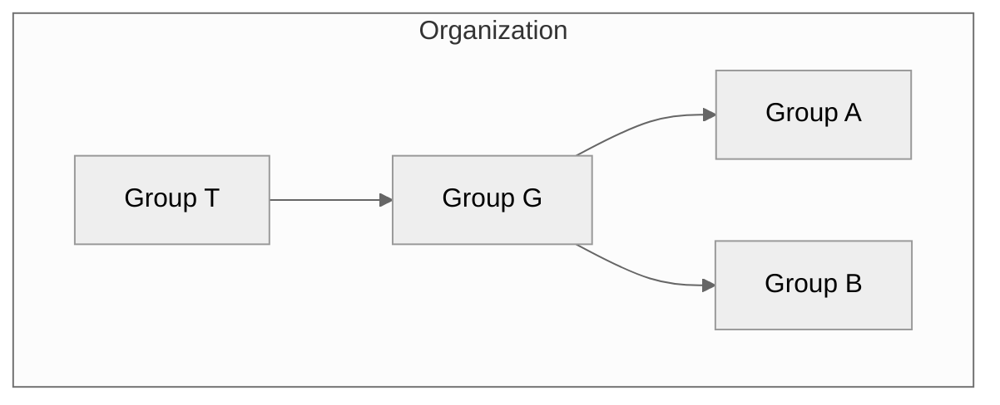



- 티어: Free, Premium, Ultimate
- 제공 서비스: GitLab.com, GitLab Self-Managed, GitLab Dedicated



GitLab에서는 그룹을 사용하여 관련된 하나 이상의 프로젝트를 동시에 관리합니다.

그룹을 사용하여 모든 그룹 멤버와 통신하고 프로젝트의 권한을 관리할 수 있습니다. 누군가 그룹에 액세스하면 그룹의 모든 프로젝트에 액세스할 수 있습니다.

그룹의 프로젝트에 대한 모든 이슈와 머지 리퀘스트, 그리고 그룹의 활동에 대한 분석을 볼 수 있습니다.

대규모 조직의 경우 [하위 그룹](subgroups/_index.md)을 만들 수도 있습니다.

그룹 생성 및 관리에 대한 자세한 내용은 [그룹 관리](manage.md)를 참조하세요.

## 그룹 계층 {#group-hierarchy}

그룹은 트리 구조로 정렬됩니다:

- **최상위 그룹**은 조직의 "루트"에서 만들어진 그룹입니다. 조직은 하나 이상의 최상위 그룹을 가질 수 있습니다. 최상위 그룹은 하나 이상의 하위 그룹을 포함할 수 있습니다.
- **부모 그룹**은 하나 이상의 하위 그룹을 포함하는 그룹입니다.
- **하위 그룹**은 다른 그룹의 일부인 그룹입니다.

예를 들어 다음 다이어그램에서:

- 조직에는 4개의 그룹이 있습니다. 최상위 그룹(T) 1개(하위 그룹(G) 1개 포함), 그리고 G 내 하위 그룹(A, B) 2개입니다.
- T는 최상위 그룹이고 G의 부모 그룹입니다.
- G는 T의 하위 그룹(자식)이고 A와 B의 부모 그룹입니다.
- A와 B는 G의 하위 그룹(자식)입니다.

## 그룹 구조 {#group-structure}

그룹을 설정하는 방식은 사용 사례, 팀 규모 및 액세스 요구 사항에 따라 달라집니다. 다음 표에서는 그룹을 구성하는 가장 일반적인 모델을 설명합니다.

<!-- vale gitlab_base.Simplicity = NO -->

| 모델 | 구조 | 사용 사례 |
| ----- | --------- | --------- |
| 단순 | 모든 프로젝트에 대해 1개 그룹입니다. | 작은 팀에서 또는 매끄러운 협업과 리소스에 대한 액세스가 필요한 특정 솔루션(예: 마케팅 웹 사이트)에서 작업합니다. |
| 팀 | 다양한 유형의 팀(예: 제품 및 엔지니어링)에 대해 다양한 그룹 또는 하위 그룹입니다. | 일부 팀이 자율적으로 작동하거나 중앙 집중식 리소스가 필요하고 외부 팀 멤버의 액세스가 제한되는 대규모 조직에서 작업합니다. |
| 클라이언트 | 각 클라이언트당 1개 그룹입니다. | 다양한 리소스와 액세스 수준이 필요한 여러 클라이언트에게 사용자 정의 솔루션을 제공합니다. |
| 기능 | 한 가지 기능(예: AI/ML) 유형에 대해 1개 그룹 또는 하위 그룹입니다. | 한 가지 기능이 특정 리소스와 주제 전문가의 협업이 필요한 복잡한 제품을 개발합니다. |

<!-- vale gitlab_base.Simplicity = YES -->

> [!note]
> GitLab Self-Managed에서 전체 조직에 대한 개요를 보려면 1개의 최상위 그룹을 만들어야 합니다. 모든 그룹의 조직 보기 만들기에 대한 더 많은 정보는 [에픽 9266 참조](https://gitlab.com/groups/gitlab-org/-/work_items/9266)를 참조하세요. 최상위 그룹은 완전한 [보안 대시보드 및 센터](../application_security/security_dashboard/_index.md), [취약성 보고서](../application_security/vulnerability_report/_index.md), [규정 준수 센터](../compliance/compliance_center/_index.md) 및 [가치 흐름 분석](value_stream_analytics/_index.md)을 통해 전체 조직에 대한 인사이트를 제공합니다.

### 그룹 구조의 권장 제한 {#recommended-limits-for-group-structure}

그룹에는 멤버십, 계층 깊이 또는 그룹 공유 수에 대해 적용되는 제한이 없습니다. 그러나 크거나 깊게 중첩된 구조는 성능을 저하시킬 수 있습니다. 대시보드를 느리게 로드할 수 있으며, 권한 계산이 시간 초과될 수 있고, 일부 작업은 `500` 오류를 반환할 수 있습니다. 그룹을 반응성 있게 유지하려면 다음 권장 제한을 준수하세요:

| 구조 | 권장 제한 | 최대 제한 | 권장 제한 이상일 때의 가능한 증상 |
| --------- | ----------------- | ------------- | ------------------------------------------- |
| 그룹당 멤버 | 1,000개 미만 | 없음 | 성능이 저하됩니다. 1,500명 이상의 멤버의 경우 작업이 시간 초과되거나 `500` 오류를 반환할 수 있습니다. |
| 부모 그룹당 하위 그룹 | 100개 미만 | 없음 | 네비게이션 및 권한 계산이 느려집니다. |
| 계층 깊이 | 5개 수준 이하 | 20개 수준 | 데이터베이스 쿼리가 시간 초과될 수 있습니다. |

권장 제한은 최대 제한과 다릅니다. 최대 제한은 GitLab이 적용하는 기술적 한계입니다. 그룹이 권장 제한을 초과하더라도 여전히 지원됩니다.

성능 문제는 이러한 제한이 결합될 때 가장 심각합니다. 예를 들어 깊은 중첩과 많은 하위 그룹을 모두 가진 그룹은 한 가지 조건만 있을 때보다 더 빨리 데이터베이스 쿼리 시간 초과를 유발할 수 있습니다.

권장 제한은 현재 성능 동작을 반영합니다. 대규모의 깊게 중첩된 구조에서 더 성능이 좋은 구조로 이동하는 데 도움이 될 계획된 작업에 대한 세부 사항은 [에픽 21582](https://gitlab.com/groups/gitlab-org/-/epics/21582)를 참조하세요.

#### 권장 제한 내에서 유지하세요 {#stay-within-the-recommended-limits}

그룹이 권장 제한에 접근하거나 초과하면 다음 해결 방법을 사용하여 성능 영향을 줄일 수 있습니다.

대규모 그룹 멤버십의 경우:

- 1,000명 이상의 멤버가 있는 그룹을 더 작은 기능 그룹으로 분할하고 각 그룹은 500명 이하의 멤버를 포함합니다. 예를 들어, 모든 엔지니어의 단일 그룹을 프론트엔드, 백엔드 및 인프라 엔지니어를 위한 별도의 그룹으로 바꿉니다.
- 1개의 대규모 그룹을 공유하는 대신 더 작은 각 그룹을 프로젝트 및 그룹과 개별적으로 공유합니다.
- 대량 멤버 변경의 경우 [그룹 멤버 API](../../api/group_members.md)를 사용하고 요청 간 지연을 두어 [멤버 관리 속도 제한](../../administration/instance_limits.md#rate-limits) 내에 머물러야 합니다.

깊거나 넓은 계층의 경우:

- 계층을 5개 수준 이하로 유지합니다.
- 모든 것을 하나의 계층 아래에 중첩하기보다는 상속된 멤버십을 공유할 필요가 없는 조직 부분에 별도의 최상위 그룹을 사용합니다.
- 단일 부모 그룹 아래의 직접 하위 그룹 수를 줄입니다.

그룹 공유의 경우:

- 개별 멤버 권한을 관리해야 할 때 중첩된 그룹 공유를 통한 공유 대신 그룹을 프로젝트에 직접 추가합니다.
- 새 하위 그룹이 공유된 그룹에서 권한을 상속하지 않으면 공유의 역할을 다른 값으로 변경한 후 다시 되돌려서 권한 재계산을 트리거합니다.
- 대량 작업 또는 자동화와 같은 많은 그룹 공유 작업을 한 번에 수행할 때 모두 병렬로 실행하는 대신 한 번에 하나씩 또는 제한된 동시성으로 실행합니다. 대규모 멤버십을 가진 그룹에 대한 많은 동시 공유 작업은 데이터베이스 경합을 생성하고 인스턴스 응답성을 저하시킬 수 있습니다.
- 그룹 간(중첩) 공유에서의 액세스는 지연된 배치 업데이트로 적용되므로 직접 프로젝트 공유보다 전파하는 데 더 오래 걸릴 것으로 예상합니다.

ID 공급자에서 동기화된 대규모 계층의 경우:

- ID 공급자에 대한 속도 제한을 피하기 위해 [LDAP 동기화](../../administration/auth/ldap/ldap_synchronization.md) 간격을 구성합니다. 동기화 중 속도 제한 오류는 사용자를 차단하거나 그룹 멤버십을 제거할 수 있습니다.

## 그룹 가시성 {#group-visibility}

프로젝트와 마찬가지로 그룹은 다음에 표시되도록 구성할 수 있습니다:

- 익명 사용자입니다.
- 모든 인증된 사용자입니다.
- 명시적 그룹 멤버만입니다.

애플리케이션 설정 수준의 [공개 수준](../../administration/settings/visibility_and_access_controls.md#restrict-visibility-levels)에 대한 제한이 그룹에도 적용됩니다. 내부로 설정하면 익명 사용자의 탐색 페이지가 비어 있습니다. 그룹 페이지에는 공개 수준 아이콘이 있습니다.

사용자는 직계 부모 그룹의 공개 수준보다 높은 공개 수준으로 하위 그룹 또는 프로젝트를 만들 수 없습니다.

## 그룹 탐색 {#explore-groups}

모든 공개 또는 내부 그룹을 탐색하려면:

1. 상단 표시줄에서 **검색 또는 이동**을 선택합니다.
1. 드롭다운에서 **탐색**을 선택합니다.
1. 왼쪽 사이드바에서 **그룹**을 선택합니다.

## 멤버인 그룹 보기 {#view-groups-you-are-a-member-of}



- **멤버** 탭이 GitLab 18.2에서 [도입되었습니다](https://gitlab.com/groups/gitlab-org/-/work_items/13781). [기능 플래그](../../administration/feature_flags/_index.md) `your_work_groups_vue`. 기본적으로 비활성화되었습니다.
- GitLab 18.3에서 [일반 공급](https://gitlab.com/gitlab-org/gitlab/-/issues/542790)입니다. `your_work_groups_vue` 기능 플래그가 제거되었습니다.



직접 또는 간접 멤버십이 있는 그룹을 보려면:

1. 상단 표시줄에서 **검색 또는 이동**을 선택합니다.
1. 드롭다운에서 **내 모든 그룹 보기**를 선택합니다.

이 페이지에는 다음을 통해 멤버인 그룹이 표시됩니다:

- 하위 그룹의 부모 그룹의 멤버십입니다.
- 그룹 또는 하위 그룹의 프로젝트의 직접 또는 상속된 멤버십입니다.

### 비활성 그룹 보기 {#view-inactive-groups}



- GitLab 18.2에서 [도입된](https://gitlab.com/groups/gitlab-org/-/work_items/13781) **비활성** 탭. [기능 플래그](../../administration/feature_flags/_index.md) `your_work_groups_vue`. 기본적으로 비활성화되었습니다.
- GitLab 18.3에서 [일반 공급](https://gitlab.com/gitlab-org/gitlab/-/issues/542790)입니다. `your_work_groups_vue` 기능 플래그가 제거되었습니다.
- GitLab 18.8에서 [도입된](https://gitlab.com/groups/gitlab-org/-/work_items/13781) **비활성** 탭 on the **그룹 찾아보기** 페이지. [기능 플래그](../../administration/feature_flags/_index.md) `explore_groups_vue`. 기본적으로 비활성화되었습니다.
- GitLab 18.11에서 [일반적으로 사용 가능](https://gitlab.com/gitlab-org/gitlab/-/issues/585432)하게 되었습니다. `explore_groups_vue` 기능 플래그가 제거되었습니다.



그룹은 삭제 대기 중이거나 아카이브되었을 때 비활성입니다.

비활성인 모든 그룹을 보려면:

1. 상단 표시줄에서 **검색 또는 이동**을 선택합니다.
1. 드롭다운에서 다음 중 하나를 선택합니다:
   - **내 모든 그룹 보기**를 선택하여 멤버인 그룹을 필터링합니다.
   - **탐색**을 선택하여 공개 또는 내부 그룹을 필터링합니다.
1. **비활성** 탭을 선택합니다.

목록의 각 비활성 그룹은 그룹이 아카이브되었거나 삭제 대기 중임을 나타내는 배지를 표시합니다.

그룹이 삭제 대기 중이면 목록에는 다음도 표시됩니다:

- 그룹이 최종 삭제로 예약된 시간입니다.
- **복원** 동작입니다. 그룹을 복원할 때:
  - **삭제 대기 중** 레이블이 제거됩니다. 그룹이 더 이상 삭제로 예약되지 않습니다.
  - 그룹이 **비활성** 탭에서 제거됩니다.

## 그룹 보기 {#view-a-group}



- 그룹 ID를 사용한 그룹 액세스가 GitLab 17.5에서 [도입되었습니다](https://gitlab.com/gitlab-org/gitlab/-/merge_requests/165889).



그룹 개요 페이지에는 그룹 및 멤버, 하위 그룹 및 프로젝트에 대한 정보가 표시됩니다. 예를 들어:

- 그룹 설명
- 최근 활동
- 만들어진 머지 리퀘스트 및 이슈의 수
- 추가된 멤버 수
- 하위 그룹 및 프로젝트
- 공유된 프로젝트
- 아카이브된 프로젝트

그룹을 보려면:

- 상단 표시줄에서 **검색 또는 이동**을 선택하고 그룹을 찾습니다.

그룹의 하위 그룹과 프로젝트를 검색하고 오름차순 또는 내림차순으로 정렬할 수 있습니다.

그룹의 이름 대신 ID를 사용하여 `https://gitlab.example.com/-/g/<id>`에서 그룹에 액세스할 수 있습니다. 예를 들어 그룹 `example-group`의 ID가 `123456`이면 `https://gitlab.example.com/example-group` 또는 `https://gitlab.example.com/-/g/123456`에서 그룹에 액세스할 수 있습니다.

## 그룹 ID 찾기 {#find-the-group-id}

[GitLab API](../../api/_index.md)를 사용하여 상호 작용하려면 그룹 ID가 필요할 수 있습니다.

그룹 ID를 찾으려면:

1. 상단 표시줄에서 **검색 또는 이동**을 선택하고 그룹을 찾습니다.
1. 그룹 개요 페이지에서 오른쪽 위 모서리에서 **조치**()을 선택합니다.
1. **그룹 ID 복사**를 선택합니다.

## 그룹 활동 보기 {#view-group-activity}

그룹의 활동을 보려면:

1. 상단 표시줄에서 **검색 또는 이동**을 선택하고 그룹을 찾습니다.
1. 왼쪽 사이드바에서 **관리** > **활동**을 선택합니다.
1. 선택 사항. 기여 유형별로 활동을 필터링하려면 탭을 선택합니다:

   - **전체**: 그룹 및 그룹 프로젝트의 그룹 멤버의 모든 기여입니다.
   - **푸시 이벤트**: 그룹의 프로젝트의 푸시 이벤트입니다.
   - **머지 이벤트**: 그룹의 프로젝트에서 허용된 머지 리퀘스트입니다.
   - **이슈 이벤트**: 그룹의 프로젝트에서 열린 및 닫힌 이슈입니다.
   - **댓글**: 그룹의 프로젝트에서 그룹 멤버가 게시한 댓글입니다.
   - **위키**: 그룹의 위키 페이지에 대한 업데이트입니다.
   - **디자인**: 그룹의 프로젝트에서 추가, 업데이트 및 제거된 디자인입니다.
   - **팀**: 그룹의 프로젝트를 떠나고 가입한 그룹 멤버입니다.

## 그룹 만들기 {#create-a-group}

그룹을 만들려면:

<!-- vale gitlab_base.FutureTense = NO -->

1. 오른쪽 위 모서리에서 **새로 만들기**() 및 **새 그룹**을 선택합니다.
1. **그룹 생성**를 선택합니다.
1. **그룹 이름** 텍스트 상자에 그룹의 이름을 입력합니다. 그룹 이름으로 사용할 수 없는 단어 목록은 [예약된 이름](../reserved_names.md)을 참조하세요.
1. **그룹 URL** 텍스트 상자에 [네임스페이스](../namespace/_index.md)에 사용되는 그룹의 경로를 입력합니다.
1. 그룹의 [**공개 수준**](../public_access.md)을 선택합니다.
1. 선택 사항. GitLab 경험을 개인화하려면:
   - **누가 이 그룹을 사용하게 됩니까?**에서 옵션을 선택합니다.
   - **이 그룹을 무엇에 사용할 것입니까?** 드롭다운 목록에서 옵션을 선택합니다.
1. 선택 사항. 그룹에 멤버를 초대하려면 **이메일 1** 텍스트 상자에 초대하려는 사용자의 이메일 주소를 입력합니다. 더 많은 사용자를 초대하려면 **다른 멤버 초대**를 선택하고 사용자의 이메일 주소를 입력합니다.
1. **그룹 생성**를 선택합니다.

<!-- vale gitlab_base.FutureTense = YES -->

<i class="fa-youtube-play" aria-hidden="true"></i> 그룹에 대한 자세한 내용은 [GitLab 네임스페이스(사용자, 그룹 및 하위 그룹)](https://youtu.be/r0sJgjR2f5A)를 보세요.

## 그룹 이름, 설명 및 아바타 편집 {#edit-group-name-description-and-avatar}

그룹 일반 설정에서 그룹 세부 정보를 편집할 수 있습니다.

사전 요구 사항:

- 그룹의 Owner 역할이 있어야 합니다.

그룹 세부 정보를 편집하려면:

1. 상단 표시줄에서 **검색 또는 이동**을 선택하고 그룹을 찾습니다.
1. 왼쪽 사이드바에서 **설정** > **일반**을 선택합니다.
1. **그룹 이름** 텍스트 상자에 그룹 이름을 입력합니다. [그룹 이름에 대한 제한](../reserved_names.md)을 참조하세요.
1. 선택 사항. **그룹 설명 (옵션)** 텍스트 상자에 그룹 설명을 입력합니다. 설명은 500자로 제한됩니다.
1. 선택 사항. **그룹 아바타** 아래에서 **파일 선택**을 선택한 후 이미지를 선택합니다. 이상적인 이미지 크기는 192 x 192 픽셀이고 최대 파일 크기는 200KB입니다.
1. **변경 사항 저장**을 선택합니다.

## 그룹 떠나기 {#leave-a-group}

그룹을 떠날 때:

- 더 이상 그룹, 하위 그룹 및 프로젝트의 멤버가 아니며 기여할 수 없습니다.
- 귀하에게 할당된 모든 이슈와 머지 리퀘스트가 할당 해제됩니다.

그룹을 떠나려면:

1. 상단 표시줄에서 **검색 또는 이동**을 선택하고 그룹을 찾습니다.
1. 그룹 개요 페이지에서 오른쪽 위 모서리에서 **조치**()을 선택합니다.
1. **그룹 나가기**를 선택한 후 다시 **그룹 나가기**를 선택합니다.

## 그룹 삭제 예약 {#schedule-a-group-for-deletion}



- GitLab 18.0에서 GitLab Premium에서 GitLab Free로 [이동](https://gitlab.com/groups/gitlab-org/-/work_items/17208)되었습니다.



기본적으로 그룹을 처음 삭제할 때 삭제 대기 상태가 됩니다. 그룹을 다시 삭제하여 즉시 제거합니다.

사전 요구 사항:

- 그룹에 대한 소유자 역할이 있어야 합니다.
- 그룹에 프로젝트가 포함되어 있으면 소유자는 [프로젝트 삭제를 허용](../../administration/settings/visibility_and_access_controls.md#restrict-project-deletion-to-administrators)해야 합니다.

그룹 및 콘텐츠를 삭제하려면:

1. 상단 표시줄에서 **검색 또는 이동**을 선택하고 그룹을 찾습니다.
1. 그룹 개요 페이지에서 오른쪽 위 모서리에서 **조치**()을 선택합니다.
1. **삭제**를 선택합니다.
1. 확인 대화 상자에서 그룹 경로를 입력하고 **예, 그룹 삭제함**을 선택합니다.

그룹 대시보드에서도 그룹을 삭제할 수 있습니다:

1. 상단 표시줄에서 **검색 또는 이동** > **내 모든 그룹 보기**를 선택합니다.
1. 삭제하려는 그룹에 대해 ()을 선택합니다.
1. **삭제**를 선택합니다.
1. 확인 대화 상자에서 그룹 경로를 입력하고 **예, 그룹 삭제함**을 선택합니다.

이 작업은 배경 작업을 추가하여 그룹 삭제를 예약합니다. GitLab.com에서는 그룹이 30일 후 삭제됩니다. GitLab Self-Managed에서는 [인스턴스 설정](../../administration/settings/visibility_and_access_controls.md#deletion-protection)을 통해 보존 기간을 수정할 수 있습니다.

그룹이 삭제로 예약되면 예약된 CI/CD 파이프라인이 실행을 중지합니다.

그룹 삭제를 예약한 사용자가 삭제가 발생하기 전에 그룹에 대한 액세스를 잃으면(예: 그룹을 떠나거나 역할이 강등되거나 그룹에서 금지됨) 삭제 작업은 대신 그룹을 복원하고 그룹은 더 이상 삭제로 예약되지 않습니다.

> [!warning]
> 그룹 삭제를 예약한 사용자가 작업이 실행되기 전에 소유자 역할 또는 관리자 액세스를 다시 획득하면 작업이 그룹을 영구적으로 제거합니다.

## 그룹 즉시 삭제 {#delete-a-group-immediately}



- GitLab 18.0에서 GitLab Premium에서 GitLab Free로 [이동](https://gitlab.com/groups/gitlab-org/-/work_items/17208)되었습니다.



기다리고 싶지 않으면 그룹을 즉시 삭제할 수 있습니다.

사전 요구 사항:

- 그룹에 대한 소유자 역할이 있어야 합니다.
- [그룹 삭제를 예약](#schedule-a-group-for-deletion)했습니다.

삭제로 예약된 그룹을 영구적으로 삭제하려면:

1. 상단 표시줄에서 **검색 또는 이동**을 선택하고 그룹을 찾습니다.
1. 그룹 개요 페이지에서 오른쪽 위 모서리에서 **조치**()을 선택합니다.
1. **영구 삭제**를 선택합니다.
1. 확인 대화 상자에서 그룹 경로를 입력하고 **예, 그룹 삭제함**을 선택합니다.

이 작업은 그룹, 하위 그룹, 프로젝트 및 이슈 및 머지 리퀘스트를 포함한 모든 관련 리소스를 삭제합니다.

## 그룹 복원 {#restore-a-group}

삭제로 예약된 그룹을 복원하려면:

1. 상단 표시줄에서 **검색 또는 이동**을 선택하고 그룹을 찾습니다.
1. 그룹 개요 페이지에서 오른쪽 위 모서리에서 **조치**()을 선택합니다.
1. **복원**을 선택합니다.

## 동작 메뉴를 사용한 그룹 관리 {#manage-groups-with-the-actions-menu}

모든 그룹 목록을 볼 수 있고 **조치** 메뉴를 사용하여 관리할 수 있습니다.

사전 요구 사항:

- 그룹을 떠나는 것을 제외한 모든 사용 가능한 동작에는 소유자 역할이 필요합니다.

그룹의 **조치** 메뉴에 액세스하려면:

1. 상단 표시줄에서 **검색 또는 이동** > **내 모든 그룹 보기**를 선택합니다.
1. **그룹** 페이지에서 그룹을 찾고 **조치** 메뉴()를 선택합니다.
1. 동작을 선택합니다.

그룹의 상태에 따라 다음 동작을 사용할 수 있습니다:

| 그룹 상태      | 사용 가능한 동작       |
| ---------------- | ----------------------- |
| 활성           | **편집**, **아카이브**, **전송**, **그룹 나가기**, **삭제** |
| Archived (아카이브됨)         | **아카이빙 해제**, **그룹 나가기**, **삭제** |
| 삭제 대기 중 | **복원**, **그룹 나가기** |

## 그룹에 대한 액세스 요청 {#request-access-to-a-group}

사용자는 관리자가 허용하는 경우 그룹의 멤버가 되도록 요청할 수 있습니다.

1. 상단 표시줄에서 **검색 또는 이동** > **내 모든 그룹 보기**를 선택합니다.
1. 오른쪽 위에서 **그룹 찾아보기**를 선택합니다.
1. **검색** 텍스트 상자에 가입하려는 그룹의 이름을 입력합니다.
1. 검색 결과에서 그룹의 이름을 선택합니다.
1. 그룹 페이지의 그룹 이름 아래에서 **접근권한 요청**을 선택합니다.

최대 10개의 가장 최근에 활발한 그룹 소유자가 요청이 포함된 이메일을 받습니다. 모든 그룹 소유자는 요청을 승인 또는 거부할 수 있습니다.

요청이 승인되기 전에 마음을 바꾸면 **액세스 요청 철회**를 선택합니다.

## 그룹 멤버 보기 {#view-group-members}

그룹의 멤버를 보려면:

1. 상단 표시줄에서 **검색 또는 이동**을 선택하고 그룹을 찾습니다.
1. 왼쪽 사이드바에서 **관리** > **멤버**를 선택합니다.

표에는 멤버의 다음 정보가 표시됩니다:

- **계정** 이름 및 사용자 이름입니다.
- 해당 **소스** of their [멤버십](../project/members/_index.md#membership-types). 여러 소스가 있는 그룹 멤버는 **멤버** 표에서 두 번 표시되며 별도의 멤버로 계산됩니다. 소유자 또는 유지보수자와 같은 높은 역할을 가진 그룹 멤버는 하위 그룹 및 프로젝트의 덜 제한적인 역할을 재정의합니다. 예를 들어 소유자 역할을 가진 그룹 멤버는 하위 그룹 또는 프로젝트에서 개발자 역할을 직접 할당받을 수 있습니다. 그러나 멤버에게 소유자 역할도 할당되어 있으므로 소유자 범위 권한을 가집니다. [이슈 502458](https://gitlab.com/gitlab-org/gitlab/-/work_items/502458)은 멤버의 소스가 최고의 효과적인 역할을 표시하는 동작에 대한 변경을 제안합니다.
- 그룹의 [**역할**](../project/members/_index.md#which-roles-you-can-assign)입니다.
- 그룹 멤버십의 **만료** 날짜입니다.
- 계정과 관련된 **활동**.

최상위 네임스페이스에서 모든 네임스페이스 멤버(및 해당 점유된 사용자)를 보려면 [**사용 할당량** 페이지를 보세요](../../subscriptions/manage_seats.md#view-seat-usage).

## 그룹의 멤버 필터링 및 정렬 {#filter-and-sort-members-in-a-group}

그룹의 멤버를 찾으려면 정렬, 필터링 또는 검색할 수 있습니다.

### 그룹 필터링 {#filter-a-group}

그룹을 필터링하여 멤버를 찾습니다. 기본적으로 그룹 및 하위 그룹의 모든 멤버가 표시됩니다.

그룹 멤버 목록에서 항목은 다음 배지를 표시할 수 있습니다:

- **SAML**, 멤버가 [SAML 계정](saml_sso/_index.md)이 연결되어 있음을 나타냅니다.
- **Enterprise**, 최상위 그룹의 멤버가 [엔터프라이즈 사용자](../enterprise_user/_index.md)임을 나타냅니다.

1. 상단 표시줄에서 **검색 또는 이동**을 선택하고 그룹을 찾습니다.
1. 왼쪽 사이드바에서 **관리** > **멤버**를 선택합니다.
1. 멤버 목록 위의 **멤버 필터링** 텍스트 상자에 검색 조건을 입력합니다. 보려면:
   - 그룹의 직접 멤버는 **멤버십 = 직접**을 선택합니다.
   - 그룹의 상속된, 공유된 및 상속된 공유 멤버는 **멤버십 = 간접**을 선택합니다.
   - 2단계 인증이 활성화되거나 비활성화된 멤버는 **2FA = 활성화됨** 또는 **2FA = 비활성화됨**을 선택합니다.
   - [엔터프라이즈 사용자](../enterprise_user/_index.md)인 최상위 그룹의 멤버는 **엔터프라이즈 = true**를 선택합니다.

### 그룹 검색 {#search-a-group}

이름, 사용자 이름 또는 [공개 이메일](../profile/_index.md#set-your-public-email)로 멤버를 검색할 수 있습니다.

1. 상단 표시줄에서 **검색 또는 이동**을 선택하고 그룹을 찾습니다.
1. 왼쪽 사이드바에서 **관리** > **멤버**를 선택합니다.
1. 멤버 목록 위의 **멤버 필터링** 상자에 검색 조건을 입력합니다.
1. **멤버 필터링** 상자의 오른쪽에서 돋보기()를 선택합니다.

### 그룹의 멤버 정렬 {#sort-members-in-a-group}

**계정**, **억세스 권한부여됨**, **역할** 또는 **마지막 로그인**으로 멤버를 정렬할 수 있습니다.

1. 상단 표시줄에서 **검색 또는 이동**을 선택하고 그룹을 찾습니다.
1. 왼쪽 사이드바에서 **관리** > **멤버**를 선택합니다.
1. 멤버 목록 위의 오른쪽 위 모서리에서 **계정** 목록에서 필터링할 조건을 선택합니다.
1. 오름차순과 내림차순 간에 정렬을 전환하려면 **계정** 목록의 오른쪽에서 화살표( 또는 )를 선택합니다.

## 그룹에 사용자 추가 {#add-users-to-a-group}



- 하위 그룹 및 프로젝트의 직접 멤버에 대한 액세스 만료 날짜가 GitLab 17.4에서 [제거](https://gitlab.com/gitlab-org/gitlab/-/issues/471051)되었습니다.



사용자에게 그룹의 모든 프로젝트에 대한 액세스 권한을 부여할 수 있습니다.

사전 요구 사항:

- 그룹의 Owner 역할이 있어야 합니다.
- GitLab Self-Managed 인스턴스의 경우:
  - [새 사용자 계정 생성이 비활성화된](../../administration/settings/sign_up_restrictions.md#disable-new-user-account-creation) 경우 관리자가 사용자를 추가해야 합니다.
  - [사용자 초대가 허용되지 않으면](../../administration/settings/visibility_and_access_controls.md#prevent-invitations-to-groups-and-projects) 관리자가 사용자를 추가해야 합니다.
  - [관리자 승인이 활성화된](../../administration/settings/sign_up_restrictions.md#turn-on-administrator-approval-for-role-promotions) 경우 관리자가 초대를 승인해야 합니다.

1. 상단 표시줄에서 **검색 또는 이동**을 선택하고 그룹을 찾습니다.
1. 왼쪽 사이드바에서 **관리** > **멤버**를 선택합니다.
1. **멤버 초대**를 선택합니다.
1. 사용자가:

   - GitLab 계정을 가진 경우 사용자 이름을 입력합니다.
   - GitLab 계정이 없는 경우 사용자의 이메일 주소를 입력합니다.

1. [기본 역할](../permissions.md) 또는 [사용자 지정 역할](../custom_roles/_index.md)을 선택합니다.
1. 선택 사항. **액세스 만료일**에 대해 날짜를 입력하거나 선택합니다. 해당 날짜부터 사용자는 더 이상 프로젝트에 액세스할 수 없습니다.

   액세스 만료 날짜를 입력하면 그룹 멤버는 액세스 만료 7일 전에 이메일 알림을 받습니다.

   > [!warning]
   > 유지보수자는 자신의 액세스 만료 날짜를 연장할 수 있는 기능을 포함하여 역할이 만료될 때까지 전체 권한을 가집니다.

1. **초대**를 선택합니다. 사용자를 초대한 경우:

   - GitLab 사용자 이름으로 사용자가 멤버 목록에 추가됩니다.
   - 이메일 주소로 사용자는 이메일 초대를 받고 계정을 만들도록 지시됩니다. 초대가 수락되지 않으면 GitLab은 2일, 5일 및 10일 후 미리 알림 이메일을 보냅니다. 수락되지 않은 초대는 90일 후 자동으로 삭제됩니다.

자동으로 추가되지 않은 멤버는 **초대됨** 탭에 표시됩니다. 이 탭에는 다음 사용자가 포함됩니다:

- 아직 초대를 수락하지 않은 사용자입니다.
- [관리자의 승인](../../administration/moderate_users.md)을 기다리는 중입니다.
- 그룹 사용자 상한선을 초과합니다.

### 승격 대기 중인 사용자 보기 {#view-users-pending-promotion}

[역할 승격에 대한 관리자 승인](../../administration/settings/sign_up_restrictions.md#turn-on-administrator-approval-for-role-promotions)이 활성화된 경우 기존 사용자를 청구 가능한 역할로 승격하는 멤버십 요청에는 관리자 승인이 필요합니다.

승격 대기 중인 사용자를 보려면:

1. 상단 표시줄에서 **검색 또는 이동**을 선택하고 그룹을 찾습니다.
1. 왼쪽 사이드바에서 **관리** > **멤버**를 선택합니다.
1. **역할 승격** 탭을 선택합니다.

**역할 승격** 탭이 표시되지 않으면 그룹에 보류 중인 승격이 없습니다.

## 그룹에서 멤버 제거 {#remove-a-member-from-the-group}

사전 요구 사항:

- Owner 역할이 있어야 합니다.
- 멤버는 그룹에 직접 멤버십을 가져야 합니다. 멤버십이 부모 그룹에서 상속된 경우 멤버는 부모 그룹에서만 제거될 수 있습니다.

그룹에서 멤버를 제거하려면:

1. 상단 표시줄에서 **검색 또는 이동**을 선택하고 그룹을 찾습니다.
1. 왼쪽 사이드바에서 **관리** > **멤버**를 선택합니다.
1. 제거하려는 멤버 옆에서 세로 줄임표()를 선택합니다.
1. **멤버 삭제**를 선택합니다.
1. 선택 사항. **멤버 삭제** 확인 대화 상자에서 다음 중 하나 또는 둘 다의 확인란을 선택합니다:
   - **추가로 하위 그룹 및 프로젝트에서 직접 사용자 멤버십을 제거합니다.**
   - **또한 이 사용자를 연결된 이슈 및 머지 리퀘스트에서 할당 해제**
1. **멤버 삭제**를 선택합니다.

GitLab 관리자는 또한 [제거된 사용자가 자신을 다시 초대할 수 없도록 보장](../project/members/_index.md#ensure-removed-users-cannot-invite-themselves-back)할 수 있습니다.

## 그룹에 프로젝트 추가 {#add-projects-to-a-group}

두 가지 방식으로 그룹에 새 프로젝트를 추가할 수 있습니다:

- 그룹을 선택한 후 **새 프로젝트**를 선택합니다. 그러면 [프로젝트 생성](../project/_index.md)을 계속할 수 있습니다.
- 프로젝트를 만드는 동안 드롭다운 목록에서 그룹을 선택합니다.

  

### 그룹에 프로젝트를 추가할 수 있는 사람 지정 {#specify-who-can-add-projects-to-a-group}

기본적으로 최소한 다음을 가진 사용자:

- 개발자 역할은 그룹 아래에 프로젝트를 만들 수 있습니다. 이 기본값은 변경할 수 있습니다.
- 유지보수자 역할은 그룹으로 프로젝트를 포크할 수 있습니다. 이 기본값은 개발자 역할의 사용자가 보호된 브랜치를 포함하는 프로젝트를 포크하지 못하도록 방지하며 변경할 수 없습니다.

그룹에서 프로젝트를 만들 수 있는 역할을 지정하려면:

1. 상단 표시줄에서 **검색 또는 이동**을 선택하고 그룹을 찾습니다.
1. 왼쪽 사이드바에서 **설정** > **일반**을 선택합니다.
1. **권한 및 그룹 기능** 섹션을 펼칩니다.
1. **프로젝트를 생성하는 데 필요한 최소 역할**에서 옵션을 선택합니다.
1. **변경 사항 저장**을 선택합니다.

전 세계적으로 이 설정을 변경하는 방법에 대한 자세한 내용은 [프로젝트를 생성하는 데 필요한 기본 최소 역할](../../administration/settings/visibility_and_access_controls.md#define-which-roles-can-create-projects)을 참조하세요.
