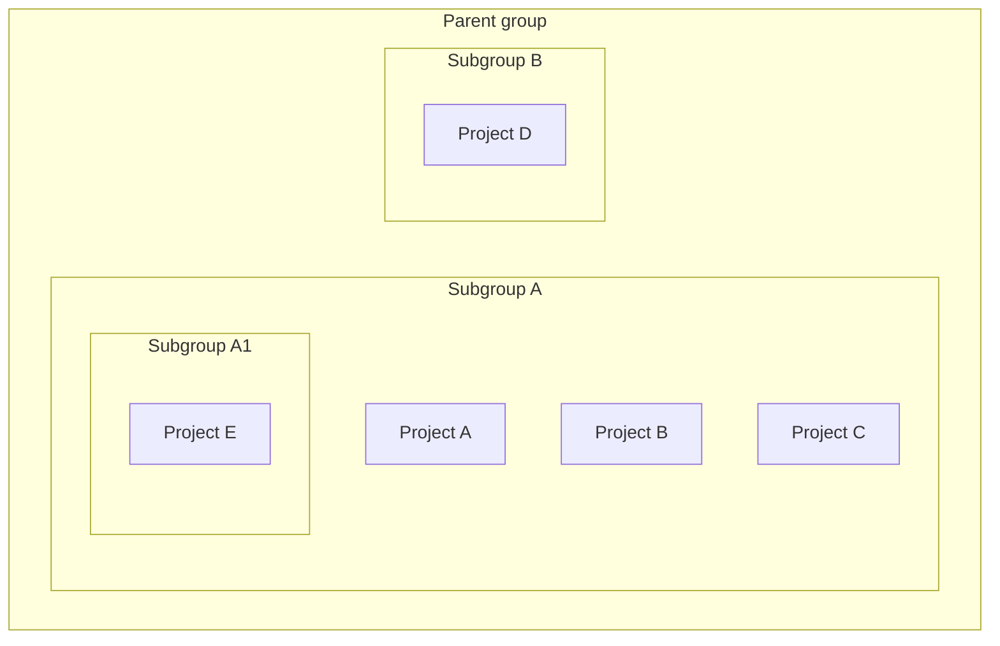
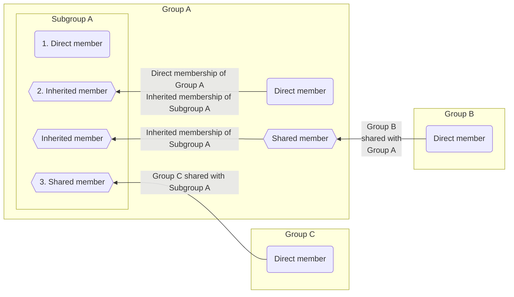



- 티어: Free, Premium, Ultimate
- 제공 서비스: GitLab.com, GitLab Self-Managed, GitLab Dedicated



GitLab [그룹](../_index.md)을 서브그룹으로 구성할 수 있습니다. 서브그룹은 다음과 같은 용도로 사용할 수 있습니다:

- 내부 콘텐츠와 외부 콘텐츠를 분리합니다. 모든 서브그룹이 자신의 [공개 수준](../../public_access.md)을 가질 수 있으므로 동일한 상위 그룹 아래에서 다양한 목적의 그룹을 호스팅할 수 있습니다.
- 대규모 프로젝트를 구성합니다. 서브그룹을 사용하여 소스 코드의 어느 부분에 액세스할 수 있는지 관리할 수 있습니다.
- 권한을 관리합니다. 사용자가 [멤버인](#subgroup-membership) 각 그룹에 대해 다른 [역할](../../permissions.md#group-permissions)을 부여합니다.

서브그룹은 다음을 수행할 수 있습니다:

- 하나의 직접 상위 그룹에 속합니다.
- 여러 서브그룹을 가질 수 있습니다.
- 최대 20 수준까지 중첩될 수 있습니다. 성능 문제를 방지하려면 그룹을 최대 5 수준 이하로 중첩합니다. 자세한 내용은 [그룹 구조의 권장 제한](../_index.md#recommended-limits-for-group-structure)을 참조하세요.
- 상위 그룹에 등록된 [러너](../../../ci/runners/_index.md)를 사용합니다:
  - 상위 그룹에 대해 구성된 암호는 서브그룹 작업에 사용할 수 있습니다.
  - 서브그룹에 속한 프로젝트에서 Maintainer 또는 Owner 역할을 가진 사용자는 상위 그룹에 등록된 러너의 세부 정보를 볼 수 있습니다.

예를 들어:

## 그룹의 서브그룹 보기 {#view-subgroups-of-a-group}

사전 요구 사항:

- 비공개 중첩 서브그룹을 보려면 비공개 서브그룹의 직접 또는 상속된 멤버여야 합니다.

그룹의 서브그룹을 보려면:

1. 상단 표시줄에서 **검색 또는 이동**을 선택하고 그룹을 찾습니다.
1. 왼쪽 사이드바에서 **서브 그룹과 프로젝트** 탭을 선택합니다.
1. 보려는 서브그룹을 선택합니다. 중첩된 서브그룹을 보려면 서브그룹을 확장()합니다.

### 공개 상위 그룹의 비공개 서브그룹 {#private-subgroups-in-public-parent-groups}

계층 목록에서 비공개 서브그룹이 있는 공개 그룹에는 확장 옵션()이 있으며, 이는 그룹에 중첩된 서브그룹이 있음을 나타냅니다. 모든 사용자가 확장 옵션()을 볼 수 있지만 비공개 서브그룹의 직접 또는 상속된 멤버만 비공개 그룹을 볼 수 있습니다.

중첩된 서브그룹의 존재 여부에 대한 정보를 비공개로 유지하려면 비공개 서브그룹을 비공개 상위 그룹에만 추가해야 합니다.

## 서브그룹 생성 {#create-a-subgroup}

사전 요구 사항:

- 다음 중 하나를 보유해야 합니다:
  - 그룹에 대한 Maintainer 또는 Owner 역할입니다.
  - [설정에 따라 결정된 역할](#change-who-can-create-subgroups)입니다. 이러한 사용자는 그룹 생성이 사용자의 설정에서 [관리자가 비활성화](../../../administration/admin_area.md#prevent-a-user-from-creating-top-level-groups)했더라도 서브그룹을 생성할 수 있습니다.

> [!note]
> GitLab Pages 서브그룹 웹사이트를 최상위 도메인 이름으로 호스팅할 수 없습니다. 예를 들어, `subgroupname.example.io`입니다.

서브그룹을 생성하려면:

1. 상단 표시줄에서 **검색 또는 이동**을 선택하고 서브그룹을 생성할 그룹을 찾습니다.
1. 상위 그룹의 개요 페이지에서 오른쪽 위 모서리에 있는 **새 하위 그룹**을 선택합니다.
1. 필드를 입력합니다. 그룹 이름으로 사용할 수 없는 [예약된 이름](../../reserved_names.md)의 목록을 봅니다.
1. **하위그룹 생성**을 선택합니다.

### 서브그룹을 생성할 수 있는 사용자 변경 {#change-who-can-create-subgroups}

사전 요구 사항:

- 그룹의 설정에 따라 그룹에 대한 Maintainer 또는 Owner 역할을 보유해야 합니다.

그룹에서 서브그룹을 생성할 수 있는 사용자를 변경하려면:

- 그룹에서 Owner 역할을 가진 사용자:
  1. 상단 표시줄에서 **검색 또는 이동**을 선택하고 그룹을 찾습니다.
  1. **설정** > **일반**을 선택합니다.
  1. **권한 및 그룹 기능**을 확장합니다.
  1. **하위 그룹을 생성할 수 있는 역할**에서 옵션을 선택합니다.
  1. **변경 사항 저장**을 선택합니다.
- 관리자:
  1. 오른쪽 위 모서리에서 **Admin**을 선택합니다.
  1. 왼쪽 사이드바에서 **개요** > **그룹**을 선택하고 그룹을 찾습니다.
  1. 그룹의 행에서 **편집**을 선택합니다.
  1. **하위그룹 생성 허용** 드롭다운 목록에서 옵션을 선택합니다.
  1. **변경 사항 저장**을 선택합니다.

자세한 내용은 [권한 표](../../permissions.md#group-permissions)를 확인하세요.

## 서브그룹 멤버십 {#subgroup-membership}



- GitLab 16.10에서 멤버 페이지의 멤버 탭에 초대된 그룹 멤버를 표시하도록 [변경](https://gitlab.com/gitlab-org/gitlab/-/issues/219230)했으며 `webui_members_inherited_users`라는 [기능 플래그](../../../administration/feature_flags/_index.md)가 포함되었습니다. 기본적으로 비활성화되었습니다.
- GitLab 17.0에서 [GitLab.com 및 GitLab Self-Managed에 대해 활성화](https://gitlab.com/gitlab-org/gitlab/-/issues/219230)되었습니다.
- 기능 플래그 `webui_members_inherited_users`가 GitLab 17.4에서 [제거](https://gitlab.com/gitlab-org/gitlab/-/merge_requests/163627)되었습니다. 초대된 그룹의 멤버는 기본적으로 표시됩니다.



그룹에 멤버를 추가하면 해당 멤버가 해당 그룹의 모든 서브그룹에도 추가됩니다. 멤버의 권한은 그룹에서 모든 서브그룹으로 상속됩니다.

서브그룹 멤버는 다음과 같을 수 있습니다:

1. 서브그룹의 [직접 멤버](../../project/members/_index.md#add-users-to-a-project)입니다.
1. 서브그룹의 상위 그룹에서 서브그룹의 [상속된 멤버](../../project/members/_index.md)입니다.
1. [서브그룹의 최상위 그룹과 공유](../../project/members/sharing_projects_groups.md#invite-a-group-to-a-group)된 그룹의 멤버입니다.
1. [간접 멤버](../../project/members/_index.md)에는 상속된 멤버와 [서브그룹 또는 해당 상위 그룹으로 초대](../../project/members/sharing_projects_groups.md#invite-a-group-to-a-group)된 그룹의 멤버가 포함됩니다.

그룹 멤버의 권한은 다음에 의해서만 변경할 수 있습니다:

- 그룹에 대한 Owner 역할을 가진 사용자입니다.
- 멤버가 추가된 그룹의 구성을 변경합니다.

### 멤버십 상속 결정 {#determine-membership-inheritance}

멤버가 상위 그룹에서 권한을 상속했는지 확인하려면:

1. 상단 표시줄에서 **검색 또는 이동**을 선택하고 그룹을 찾습니다.
1. 왼쪽 사이드바에서 **관리** > **멤버**를 선택합니다. 멤버의 상속 정보가 **소스** 열에 표시됩니다.

예제 서브그룹 **Four**의 멤버 목록:

이전 스크린샷에서:

- 5명의 멤버가 그룹 **Four**에 액세스할 수 있습니다.
- 사용자 0은 그룹 **Four**에서 Reporter 역할을 가지며 그룹 **One**에서 권한을 상속받았습니다:
  - 사용자 0은 그룹 **One**의 직접 멤버입니다.
  - 그룹 **One**은 계층 구조에서 그룹 **Four** 위에 있습니다.
- 사용자 1은 그룹 **Four**에서 Developer 역할을 가지며 그룹 **Two**에서 권한을 상속받았습니다:
  - 사용자 1은 그룹 **Two**의 직접 멤버이며, 이는 그룹 **One**의 서브그룹입니다.
  - 그룹 **One** / **Two**는 계층 구조에서 그룹 **Four** 위에 있습니다.
- 사용자 2는 그룹 **Four**에서 Developer 역할을 가지며 그룹 **Three**에서 권한을 상속받았습니다:
  - 사용자 2는 그룹 **Three**의 직접 멤버이며, 이는 그룹 **Two**의 서브그룹입니다. 그룹 **Two**는 그룹 **One**의 서브그룹입니다.
  - 그룹 **One** / **Two** / **Three**은 계층 구조에서 그룹 **Four** 위에 있습니다.
- 사용자 3은 그룹 **Four**의 직접 멤버입니다. 즉, 그룹 **Four**에서 직접 Maintainer 역할을 얻습니다.
- 관리자는 그룹 **Four**에 대한 Owner 역할을 가지며 모든 서브그룹의 멤버입니다. 따라서 사용자 3과 마찬가지로 **소스** 열은 직접 멤버임을 나타냅니다.

멤버는 [상속 또는 직접 멤버십으로 필터링](../_index.md#filter-a-group)할 수 있습니다.

### 상위 그룹 멤버십 재정의 {#override-ancestor-group-membership}

서브그룹에서 Owner 역할을 가진 사용자는 여기에 멤버를 추가할 수 있습니다.

사용자에게 상위 그룹에서 가진 역할보다 낮은 서브그룹의 역할을 부여할 수 없습니다. 상위 그룹에서 사용자의 역할을 재정의하려면 더 높은 역할을 사용하여 사용자를 서브그룹에 다시 추가합니다. 예를 들어:

- 사용자 1을 그룹 **Two**에 Developer 역할로 추가하면 사용자 1은 그룹 **Two**의 모든 서브그룹에서 해당 역할을 상속합니다.
- 사용자 1에게 그룹 **Four**(아래 **One / Two / Three**)에서 Maintainer 역할을 부여하려면 Maintainer 역할로 사용자 1을 다시 그룹 **Four**에 추가합니다.
- 사용자 1이 그룹 **Four**에서 제거되면 사용자의 역할은 그룹 **Two**에서의 역할로 돌아갑니다. 사용자 1은 그룹 **Four**에서 다시 Developer 역할을 가집니다.

## 서브그룹 멘션 {#mention-subgroups}

에픽, 이슈, 커밋 및 머지 리퀘스트에서 서브그룹을 멘션([`@<subgroup_name>`](../../discussions/_index.md#mentions))하면 해당 그룹의 모든 직접 멤버에게 알림이 전송됩니다. 서브그룹의 상속된 멤버는 멘션으로 인한 알림을 받지 않습니다. 멘션은 프로젝트 및 그룹과 동일하게 작동하며 알림을 받을 멤버 그룹을 선택할 수 있습니다.
