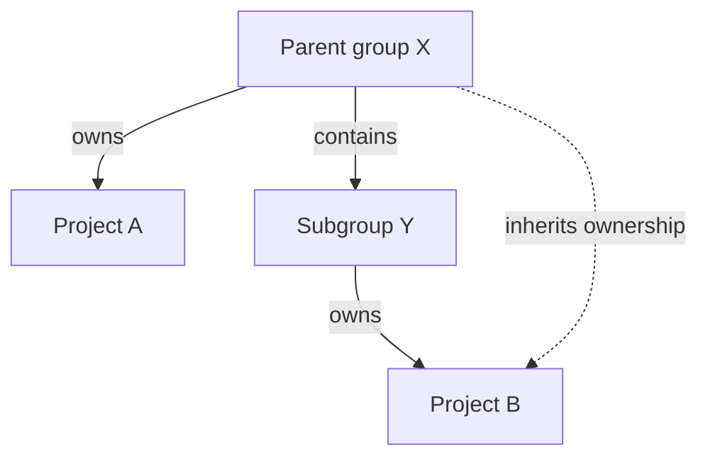



- 티어: Premium, Ultimate
- 제공 서비스: GitLab.com, GitLab Self-Managed, GitLab Dedicated



`CODEOWNERS` 파일은 특정 파일 및 디렉터리에 대한 책임자를 정의하는 데 도움이 됩니다. 패턴 매칭, 섹션 및 상속 규칙을 사용하여 머지 리퀘스트에 검토자를 할당하고 병합 전에 승인을 요구할 수 있습니다.

## 패턴 매칭 {#pattern-matching}

GitLab은 `File::fnmatch`을(를) `File::FNM_DOTMATCH` 및 `File::FNM_PATHNAME` 플래그를 설정하여 패턴 매칭에 사용합니다:

- 리포지토리 구조는 격리된 파일 시스템처럼 취급됩니다.
- 패턴은 셸 파일명 일치 규칙의 부분 집합을 따르며 정규 표현식이 아닙니다.
- `File::FNM_DOTMATCH` 플래그는 `*`이(가) `.gitignore`과 같은 도트파일과 일치하도록 합니다.
- `File::FNM_PATHNAME` 플래그는 `*`이(가) `/` 경로 구분 기호와 일치하는 것을 방지합니다.
- `**`은(는) 디렉터리를 재귀적으로 일치시킵니다. 예를 들어 `**/*.rb`은(는) `config/database.rb` 및 `app/controllers/users/stars_controller.rb`과(와) 일치합니다.

## 기본 코드 소유자 및 선택적 섹션 {#default-code-owners-and-optional-sections}

기본 소유자의 구문과 [선택적 섹션](reference.md#optional-sections) 및 필수 승인을 결합하려면 기본 소유자를 끝에 배치합니다:

```plaintext
[Documentation][2] @docs-team
docs/
README.md

^[Database] @database-team
model/db/
config/db/database-setup.md @docs-team
```

## 일반 항목 및 섹션 {#regular-entries-and-sections}

섹션 외부의 경로에 대한 기본 코드 소유자를 설정하면 해당 승인이 항상 필요합니다. 이러한 항목은 섹션에 의해 재정의되지 않습니다. 섹션 없는 항목은 다른 이름 없는 섹션인 것처럼 취급됩니다:

```plaintext
# Required for all files
* @general-approvers

[Documentation] @docs-team
docs/
README.md
*.txt

[Database] @database-team
model/db/
config/db/database-setup.md @docs-team
```

이 예에서:

- `@general-approvers`은(는) 재정의 없이 모든 위치의 모든 항목을 소유합니다.
- `@docs-team`은(는) `Documentation` 섹션의 모든 항목을 소유합니다.
- `@database-team`은(는) `Database` 섹션의 모든 항목을 소유하며, `config/db/database-setup.md`을(를) 제외하고 `@docs-team`에 할당하는 재정의가 있습니다.
- `model/db/CHANGELOG.txt`을(를) 수정하는 머지 리퀘스트는 `@general-approvers`, `@docs-team` 및 `@database-team` 그룹 각각에서 하나씩 세 가지 승인이 필요합니다.

이 동작을 [섹션의 기본 소유자](reference.md#set-default-code-owner-for-a-section)만 사용할 때와 비교합니다. 섹션의 특정 항목이 섹션 기본값을 재정의합니다.

## 중복 이름이 있는 섹션 {#sections-with-duplicate-names}

여러 섹션이 동일한 이름을 가지면 결합됩니다. 또한 섹션 제목은 대소문자를 구분하지 않습니다. 예를 들어:

```plaintext
[Documentation]
ee/docs/    @docs
docs/       @docs

[Database]
README.md  @database
model/db/   @database

[DOCUMENTATION]
README.md  @docs
```

이 코드는 `Documentation` 섹션 헤더 아래에 세 개의 항목과 `Database` 아래에 두 개의 항목을 생성합니다. `Documentation` 및 `DOCUMENTATION` 섹션 아래에 정의된 항목이 결합되며 첫 번째 섹션의 대소문자를 사용합니다.

## 특정 파일 또는 디렉터리에 대한 코드 소유자 정의 {#define-code-owners-for-specific-files-or-directories}

파일 또는 디렉터리가 `CODEOWNERS` 파일의 여러 항목과 일치할 때 마지막 패턴과 일치하는 사용자가 사용됩니다. 이를 통해 항목을 합리적인 방식으로 정렬할 때 더 구체적으로 정의된 파일 또는 디렉터리에 대해 더 구체적인 소유자를 정의할 수 있습니다.

예를 들어 다음 `CODEOWNERS` 파일에서:

```plaintext
# This line would match the file terms.md
*.md @doc-team

# This line would also match the file terms.md
terms.md @legal-team
```

`terms.md`의 코드 소유자는 `@legal-team`입니다.

## 코드 소유자의 여러 승인 요구 {#require-multiple-approvals-from-code-owners}

머지 리퀘스트의 승인 영역에서 코드 소유자 섹션에 대한 여러 승인을 요구할 수 있습니다. 섹션 이름 뒤에 숫자 `n`을(를) 괄호로 추가합니다(예: `[2]` 또는 `[3]`). 이는 이 섹션의 코드 소유자로부터 `n` 승인을 요구합니다. `n`의 유효한 항목은 정수 `≥ 1`입니다. `[1]`은(는) 기본값이므로 선택 사항입니다. `n`의 유효하지 않은 값은 `1`로 처리됩니다.

> [!warning]
> [이슈 384881](https://gitlab.com/gitlab-org/gitlab/-/issues/385881)은(는) 이 설정의 동작에 대한 변경을 제안합니다. 의도적으로 유효하지 않은 값을 설정하지 마십시오. 향후 유효해질 수 있으며 예기치 않은 동작을 유발할 수 있습니다.

코드 소유자의 여러 승인을 요구하려면:

1. 상단 바에서 **검색 또는 이동**을 선택하고 프로젝트를 찾습니다.
1. 왼쪽 사이드바에서 **설정** > **리포지토리**를 선택합니다.
1. **브랜치 규칙**을(를) 펼칩니다.
1. 기본 브랜치 옆에서 **상세 보기**를 선택합니다.
1. **코드 소유자 승인** 아래의 토글을 켭니다.
1. `CODEOWNERS` 파일을 편집하여 여러 승인에 대한 규칙을 추가합니다.

예를 들어 `[Documentation]` 섹션에 대해 두 가지 승인을 요구하려면:

```plaintext
[Documentation][2]
*.md @tech-writer-team

[Ruby]
*.rb @dev-team
```

승인 영역의 `Documentation` 코드 소유자 섹션에는 두 가지 승인이 필요함이 표시됩니다:


## 그룹 상속 및 적격성 {#group-inheritance-and-eligibility}



이 예에서:

- 상위 그룹 X(`group-x`)는 프로젝트 A를 소유합니다.
- 상위 그룹 X는 또한 하위 그룹인 하위 그룹 Y(`group-x/subgroup-y`)를 포함합니다.
- 하위 그룹 Y는 프로젝트 B를 소유합니다.

적격 코드 소유자는:

- 프로젝트 A: 프로젝트 A가 하위 그룹 Y에 속하지 않기 때문에 그룹 X의 구성원만.
- 프로젝트 B: 그룹 X와 하위 그룹 Y의 구성원 모두.

### 상위 그룹과 공유되는 그룹 {#groups-shared-with-parent-groups}



- GitLab 18.5에서 `check_inherited_groups_for_codeowners`라는 [기능 플래그](../../../administration/feature_flags/_index.md)로 [도입](https://gitlab.com/gitlab-org/gitlab/-/merge_requests/203298)되었습니다. 기본적으로 사용 중지됩니다.
- GitLab 18.6에서 [GitLab.com, GitLab Self-Managed 및 GitLab Dedicated에 사용으로 설정](https://gitlab.com/gitlab-org/gitlab/-/issues/566627)되었습니다.
- GitLab 18.8에서 [정식 출시(GA)](https://gitlab.com/gitlab-org/gitlab/-/work_items/579541)되었습니다. 기능 플래그 `check_inherited_groups_for_codeowners`이 제거되었습니다.



그룹 멤버가 직접 속하지 않은 프로젝트의 코드 소유자로 적격이 되도록 하려면 [그룹을 초대](../members/sharing_projects_groups.md#invite-a-group-to-a-group)하여 프로젝트의 상위 그룹에 추가할 수 있습니다. 그룹을 초대할 때 직접 멤버는 상위 그룹 계층의 모든 프로젝트의 코드 소유자로 적격이 됩니다.

사전 요구 사항:

- 다른 그룹을 초대하는 그룹에 대해 소유자 역할이 필요합니다.
- 그룹을 초대할 때 개발자, 유지 관리자 또는 소유자 역할을 할당해야 합니다.

예를 들어 이 계층에서:

```plaintext
group-x
├── engineering-group
└── product-group
    └── project-a
```

`engineering-group`을(를) `product-group`에 초대하면 `engineering-group`의 멤버가 `project-a`의 코드 소유자로 적격이 됩니다. `engineering-group`을(를) `project-a`에 직접 초대할 필요가 없습니다.

초대된 그룹의 직접 멤버만 코드 소유자로 적격입니다. 초대된 그룹에서 멤버십을 상속하는 멤버는 적격이 아닙니다.

## 오류 처리 {#error-handling}

### 공백이 있는 항목 {#entries-with-spaces}

백슬래시를 사용하여 경로의 공백을 이스케이프합니다:

```plaintext
path\ with\ spaces/*.md @owner
```

이스케이프하지 않으면 GitLab은 `folder with spaces/*.md @group`을(를) `path: "folder", owners: " with spaces/*.md @group"`로 구문 분석합니다.

### 구문 분석 불가능한 섹션 {#unparsable-sections}



- GitLab 17.11에서 [변경되었습니다](https://gitlab.com/gitlab-org/gitlab/-/merge_requests/185180)(항목으로 구문 분석하는 대신 구문 분석 불가능한 섹션 제목을 무시하도록).



섹션 제목을 구문 분석할 수 없는 경우 GitLab:

- 제목을 무시합니다.
- 제목 다음에 오는 항목을 이전 섹션에 추가합니다. 이전 섹션이 없으면 항목이 기본 섹션에 추가됩니다.
- `Unparsable sections` 오류를 표시합니다. [`CODEOWNERS` 파일](troubleshooting.md#validate-your-codeowners-file)을(를) 볼 때.

`Unparsable sections` 오류는 GitLab이 여전히 사용할 수 있는 일부 형식이 잘못된 제목(예: `[Docs]]` 또는 `[Docs][ 1]`)에 대해서도 표시됩니다. GitLab은 이러한 제목을 섹션으로 취급하므로 오류가 항상 제목이 무시됨을 의미하지는 않습니다.

#### 기본 섹션 이후 {#after-the-default-section}

```plaintext
* @group

[Section name
docs/ @docs_group
```

GitLab은 제목 `[Section name`을(를) 무시합니다. 기본 섹션에는 두 가지 규칙이 포함됩니다:

- `*`, `@group`에 의해 소유됨
- `docs/`, `@docs_group`에 의해 소유됨

#### 명명된 섹션 이후 {#after-a-named-section}

```plaintext
[Docs]
docs/**/* @group

[Section name
docs/ @docs_group
```

GitLab은 제목 `[Section name`을(를) 무시합니다. `[Docs]` 섹션에는 두 가지 규칙이 포함됩니다:

- `docs/**/*`, `@group`에 의해 소유됨
- `docs/`, `@docs_group`에 의해 소유됨

### 형식이 잘못된 소유자 {#malformed-owners}

각 항목에는 하나 이상의 소유자가 포함되어야 합니다. 형식이 잘못된 소유자는 유효하지 않으며 무시됩니다:

```plaintext
/path/* @group user_without_at_symbol @user_with_at_symbol
```

이 항목은 `@group` 및 `@user_with_at_symbol`에 의해 소유됩니다.

### 접근 불가능하거나 잘못된 소유자 {#inaccessible-or-incorrect-owners}

GitLab은 접근 불가능하거나 잘못된 소유자를 무시합니다. 예를 들어:

```plaintext
* @group @grou @username @i_left @i_dont_exist example@gitlab.com invalid@gitlab.com
```

`@group`, `@username` 및 `example@gitlab.com`만 접근 가능한 경우 GitLab은 나머지를 무시합니다.

### 소유자 없음 {#zero-owners}

항목에 소유자가 없거나 [접근 가능한 소유자](#inaccessible-or-incorrect-owners)가 없으면 항목은 유효하지 않습니다. 이 규칙은 절대 만족될 수 없으므로 GitLab은 머지 리퀘스트에서 자동 승인합니다.

> [!note]
> 보호된 브랜치에 `Require code owner approval`이(가) 활성화되어 있으면 소유자가 없는 규칙도 적용됩니다.

### 최소 승인 {#minimum-approvals}

섹션에 대해 [승인 수를 정의](#require-multiple-approvals-from-code-owners)할 때 최소 승인 수는 `1`입니다. 승인 수를 `0`로 설정하면 GitLab이 하나의 승인을 요구합니다.
