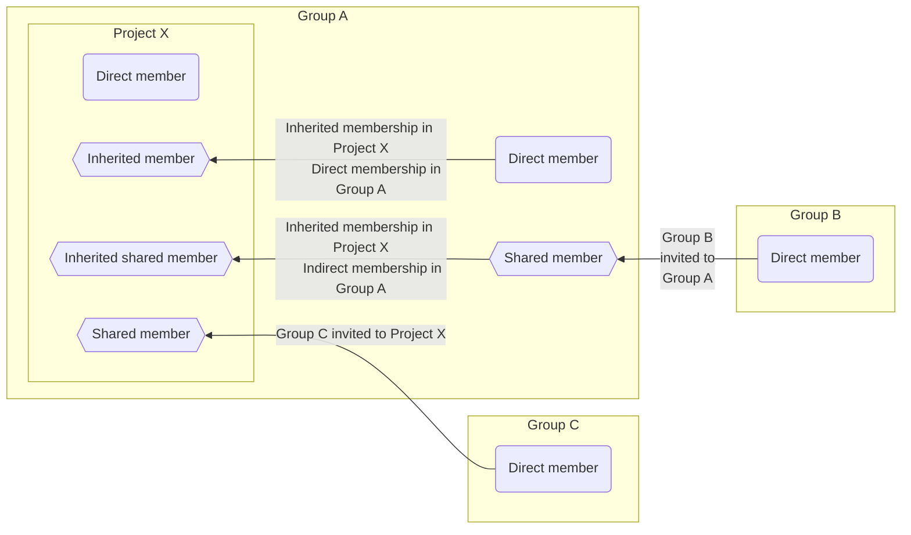
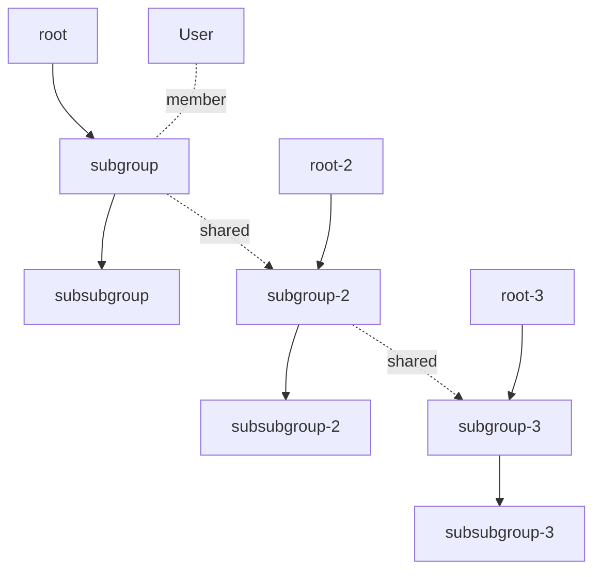



- 티어: Free, Premium, Ultimate
- 제공 서비스: GitLab.com, GitLab Self-Managed, GitLab Dedicated



멤버는 프로젝트에 액세스할 수 있는 사용자 및 그룹입니다. 멤버를 프로젝트에 직접 추가하거나 그룹을 통해 액세스를 상속받을 수 있습니다.

각 멤버는 프로젝트에서 수행할 수 있는 작업을 결정하는 역할을 가집니다. 적절한 역할을 가진 프로젝트 멤버는 프로젝트에 사용자를 추가하고, 프로젝트에서 사용자를 제거하고, 액세스 요청을 관리하여 프로젝트 리소스에 대한 액세스를 제어할 수 있습니다.

## 멤버십 유형 {#membership-types}



- GitLab 16.10에서 멤버 페이지의 멤버 탭에 초대된 그룹 멤버를 표시하도록 [변경](https://gitlab.com/gitlab-org/gitlab/-/issues/219230)했으며 `webui_members_inherited_users`라는 [기능 플래그](../../../administration/feature_flags/_index.md)가 포함되었습니다. 기본적으로 비활성화되었습니다.
- 기능 플래그 `webui_members_inherited_users`이 GitLab 17.0에서 [GitLab.com 및 GitLab Self-Managed에서 활성화되었습니다](https://gitlab.com/gitlab-org/gitlab/-/issues/219230).
- 기능 플래그 `webui_members_inherited_users`가 GitLab 17.4에서 [제거](https://gitlab.com/gitlab-org/gitlab/-/merge_requests/163627)되었습니다. 초대된 그룹의 멤버는 기본적으로 표시됩니다.



사용자는 그룹 또는 프로젝트의 멤버가 직접 또는 간접적으로 될 수 있습니다. 간접 멤버십은 상속되거나 공유되거나 상속된 공유일 수 있습니다.

| 멤버십 유형                               | 멤버십 프로세스 |
| --------------------------------------------- | ------------------ |
| 직접 | 사용자가 현재 그룹 또는 프로젝트에 직접 추가됩니다. |
| 상속됨 | 사용자는 현재 그룹 또는 프로젝트를 포함하는 상위 그룹의 멤버입니다. |
| [공유됨](sharing_projects_groups.md) | 사용자는 현재 그룹 또는 프로젝트에 초대된 그룹의 멤버입니다. |
| [상속된 공유](sharing_projects_groups.md#invite-a-group-to-a-group) | 사용자는 현재 그룹 또는 프로젝트의 상위 항목에 초대된 그룹의 멤버입니다. |
| 간접 | 상속되거나 공유되거나 상속된 공유 멤버에 대한 포괄적인 용어입니다. |

이전 예제에서:

- **운영자**는 **demo** 그룹에서 상속된 멤버입니다.
- **User 0**은 **demo** 그룹에서 상속된 멤버입니다.
- **User 1**은 이 프로젝트에 초대된 **Acme** 그룹에서 공유된 멤버입니다.
- **User 2**는 **Toolbox** 그룹에서 상속된 공유 멤버이며, **demo** 그룹에 초대되어 있습니다.
- **User 3**은 이 프로젝트에 추가된 직접 멤버입니다.

## 보안 고려 사항 {#security-considerations}

Git은 분산 버전 제어 시스템(DVCS)입니다. 소스 코드로 작업하는 모든 사용자는 전체 리포지토리의 로컬 복사본을 가집니다.

GitLab에서 리포지토리, 개발자, 유지 관리자 또는 소유자 역할을 가진 모든 프로젝트 멤버는 리포지토리를 복제하여 로컬 복사본을 만들 수 있습니다. 사용자는 로컬 복사본을 얻은 후 다음을 포함하여 리포지토리 전체를 어디든지 업로드할 수 있습니다:

- 자신이 제어하는 다른 프로젝트입니다.
- 다른 서버입니다.
- 외부 호스팅 서비스입니다.

액세스 제어는 리포지토리에 이미 액세스 권한이 있는 사용자의 의도적인 소스 코드 공유를 방지할 수 없습니다. 모든 Git 관리 플랫폼은 분산 버전 제어 시스템의 이러한 고유한 특성을 가집니다.

승인된 사용자의 의도적인 공유를 방지할 수는 없지만, 의도하지 않은 공유 및 정보 파괴를 방지하기 위해 다음 단계를 수행할 수 있습니다:

- [프로젝트에 사용자를 추가](#add-users-to-a-project)할 수 있는 사용자를 제어합니다.
- [보호된 브랜치](../repository/branches/protected.md)를 사용하여 권한 없는 강제 푸시를 방지합니다.
- 프로젝트 멤버십을 정기적으로 검토하고 더 이상 액세스가 필요하지 않은 사용자를 제거합니다.

## 프로젝트에 사용자 추가 {#add-users-to-a-project}



- 하위 그룹 및 프로젝트의 직접 멤버에 대한 액세스 만료 날짜가 GitLab 17.4에서 [제거](https://gitlab.com/gitlab-org/gitlab/-/issues/471051)되었습니다.



프로젝트에 사용자를 추가하여 직접 멤버가 되고 작업을 수행할 수 있는 권한을 가지도록 합니다.

사전 요구 사항:

- Maintainer 또는 Owner 역할이 있어야 합니다.
- [그룹 멤버십 잠금](../../group/access_and_permissions.md#prevent-members-from-being-added-to-projects-in-a-group)을 비활성화해야 합니다.
- GitLab Self-Managed 인스턴스의 경우:
  - [새 사용자 계정이 비활성화된](../../../administration/settings/sign_up_restrictions.md#disable-new-user-account-creation) 경우, 관리자가 사용자를 추가해야 합니다.
  - [사용자 초대가 허용되지 않으면](../../../administration/settings/visibility_and_access_controls.md#prevent-invitations-to-groups-and-projects) 관리자가 사용자를 추가해야 합니다.
  - [관리자 승인이 활성화된](../../../administration/settings/sign_up_restrictions.md#turn-on-administrator-approval-for-role-promotions) 경우 관리자가 초대를 승인해야 합니다.

프로젝트에 사용자를 추가하려면:

1. 상단 바에서 **검색 또는 이동**을 선택하고 프로젝트를 찾습니다.
1. 왼쪽 사이드바에서 **관리** > **멤버**를 선택합니다.
1. **멤버 초대**를 선택합니다.
1. 사용자가:

   - GitLab 계정이 있으면 사용자 이름을 입력합니다.
   - GitLab 계정이 없으면 이메일 주소를 입력합니다.

1. [기본 역할](../../permissions.md) 또는 [사용자 지정 역할](../../custom_roles/_index.md)을 선택합니다.
1. 선택 사항. **액세스 만료일**을 선택합니다. 해당 날짜부터 사용자는 더 이상 프로젝트에 액세스할 수 없습니다.

   액세스 만료일을 선택하면, 프로젝트 멤버는 액세스 만료 7일 전에 이메일 알림을 받습니다.

   > [!warning]
   > 유지보수자는 자신의 액세스 만료 날짜를 연장할 수 있는 기능을 포함하여 역할이 만료될 때까지 전체 권한을 가집니다.

1. **초대**를 선택합니다. 다음을 사용하여 사용자를 초대한 경우:

   - GitLab 사용자 이름: 멤버 목록에 추가됩니다.
   - 이메일 주소: 초대가 이메일 주소로 전송되고, 계정을 생성하라는 메시지가 표시됩니다. 초대가 수락되지 않으면 GitLab은 2일, 5일 및 10일 후 미리 알림 이메일을 보냅니다. 수락되지 않은 초대는 90일 후 자동으로 삭제됩니다.

### 할당할 수 있는 역할 {#which-roles-you-can-assign}

할당할 수 있는 최대 역할은 그룹에 대해 유지 관리자 또는 소유자 역할이 있는지 여부에 따라 다릅니다. 예를 들어, 설정할 수 있는 최대 역할은:

- 소유자(`50`) - 프로젝트에 대해 소유자 역할이 있는 경우입니다.
- 유지 관리자(`40`) - 프로젝트에 대해 유지 관리자 역할이 있는 경우입니다.

소유자 [역할](../../permissions.md#project-permissions)은 그룹에만 추가할 수 있습니다.

## 프로젝트 멤버 보기 {#view-project-members}

프로젝트의 멤버를 보려면:

1. 상단 바에서 **검색 또는 이동**을 선택하고 프로젝트를 찾습니다.
1. 왼쪽 사이드바에서 **관리** > **멤버**를 선택합니다.

표에는 멤버의 다음 정보가 표시됩니다:

- **계정** 이름 및 사용자 이름입니다.
- 해당 **소스** of their [멤버십](#membership-types). 투명성을 위해 GitLab은 프로젝트 멤버의 모든 멤버십 소스를 표시합니다. 여러 멤버십 소스를 가진 멤버는 별도의 멤버로 표시되고 계산됩니다. 예를 들어, 멤버가 직접 및 상속을 통해 프로젝트에 추가된 경우, 멤버는 **멤버** 표에 다른 소스와 함께 두 번 표시되고, 프로젝트의 두 명의 개별 멤버로 계산됩니다.
- 프로젝트의 [**역할**](#which-roles-you-can-assign).
- 프로젝트 멤버십의 **만료** 날짜입니다.
- 계정과 관련된 **활동**.

### 승격 대기 중인 사용자 보기 {#view-users-pending-promotion}

[역할 승격에 대한 관리자 승인](../../../administration/settings/sign_up_restrictions.md#turn-on-administrator-approval-for-role-promotions)이 활성화된 경우 기존 사용자를 청구 가능한 역할로 승격하는 멤버십 요청에는 관리자 승인이 필요합니다.

승격 대기 중인 사용자를 보려면:

1. 상단 바에서 **검색 또는 이동**을 선택하고 프로젝트를 찾습니다.
1. 왼쪽 사이드바에서 **관리** > **멤버**를 선택합니다.
1. **역할 승격** 탭을 선택합니다.

**역할 승격** 탭이 표시되지 않으면 프로젝트에 승격 대기 중인 항목이 없습니다.

## 만료 및 역할 업데이트 {#updating-expiration-and-role}

사용자가:

- 프로젝트의 직접 멤버인 경우 **만료** 및 **역할** 필드를 프로젝트에서 직접 업데이트할 수 있습니다.
- 상속된, 공유된 또는 상속된 공유 멤버인 경우 **만료** 및 **역할** 필드를 멤버가 시작한 그룹에서 업데이트해야 합니다.

## 프로젝트를 그룹과 공유 {#share-a-project-with-a-group}

사용자를 하나씩 추가하는 대신 [프로젝트를 전체 그룹과 공유](sharing_projects_groups.md)할 수 있습니다.

## 다른 프로젝트에서 멤버 가져오기 {#import-members-from-another-project}

다른 프로젝트의 직접 멤버를 자신의 프로젝트로 가져올 수 있습니다. 가져온 프로젝트 멤버는 가져온 프로젝트와 동일한 권한을 유지합니다.

> [!note]
> 프로젝트의 직접 멤버만 가져옵니다. 프로젝트의 상속된 또는 공유된 멤버는 가져오지 않습니다.

사전 요구 사항:

- Maintainer 또는 Owner 역할이 있어야 합니다.

가져오는 멤버의 대상 프로젝트에 대한 역할이:

- 유지 관리자인 경우 소스 프로젝트에 대해 소유자 역할을 가진 멤버는 유지 관리자 역할로 가져옵니다.
- 소유자인 경우 소스 프로젝트에 대해 소유자 역할을 가진 멤버는 소유자 역할로 가져옵니다.

프로젝트의 멤버를 가져오려면:

1. 상단 바에서 **검색 또는 이동**을 선택하고 프로젝트를 찾습니다.
1. 왼쪽 사이드바에서 **관리** > **멤버**를 선택합니다.
1. **프로젝트에서 가져오기**를 선택합니다.
1. 프로젝트를 선택합니다. 유지 관리자인 프로젝트만 볼 수 있습니다.
1. **프로젝트 멤버 가져오기**를 선택합니다.

가져오기가 성공하면 성공 메시지가 표시됩니다. **멤버** 탭에서 가져온 멤버를 보려면 페이지를 새로 고칩니다.

## 프로젝트에서 멤버 제거 {#remove-a-member-from-a-project}

사용자가:

- 프로젝트의 직접 멤버인 경우 프로젝트에서 직접 제거할 수 있습니다.
- 상위 그룹의 상속된 멤버인 경우 상위 그룹 자체에서만 제거할 수 있습니다.

사전 요구 사항:

- 소유자 역할이 없는 멤버를 제거할 때 유지 관리자 또는 소유자 역할입니다.
- 소유자 역할을 가진 멤버를 제거할 때 소유자 역할입니다.

프로젝트에서 멤버를 제거하려면:

1. 상단 바에서 **검색 또는 이동**을 선택하고 프로젝트를 찾습니다.
1. 왼쪽 사이드바에서 **관리** > **멤버**를 선택합니다.
1. 제거하려는 프로젝트 멤버 옆에서 **멤버 삭제**를 선택합니다.
1. 선택 사항. 확인 대화 상자에서 **추가로 관련된 이슈 및 머지 리퀘스트에서 이 사용자를 지정 해제합니다.** 체크박스를 선택합니다.
1. 비공개 프로젝트에서 민감한 정보 누출을 방지하려면, 멤버가 비공개 리포지토리를 포크했거나 웹후크를 생성하지 않았는지 확인합니다. 기존 포크는 상위 프로젝트에서 변경 사항을 계속 받으며, 웹후크는 계속 업데이트를 받습니다. 프로젝트가 그룹 외부에서 포크되는 것을 방지하기 위해 프로젝트를 구성할 수도 있습니다 [그룹 외부에서 포크되지 않도록](../../group/access_and_permissions.md#prevent-project-forking-outside-group).
1. **멤버 삭제**를 선택합니다.

## 제거된 사용자가 자신을 다시 초대할 수 없도록 보장 {#ensure-removed-users-cannot-invite-themselves-back}

유지 관리자 또는 소유자 역할을 가진 사용자는 관리자가 제거한 후 그룹 또는 프로젝트에 다시 참여할 수 있는 경쟁 조건을 악용할 수 있습니다.

이 문제를 방지하기 위해 GitLab 관리자는 다음을 수행할 수 있습니다:

- [GitLab Rails 콘솔](../../../administration/operations/rails_console.md)에서 악의적인 사용자 세션을 제거합니다.
- 악의적인 사용자를 가장하여:
  - 프로젝트에서 사용자를 제거합니다.
  - GitLab에서 사용자를 로그아웃합니다.
- 악의적인 사용자 계정을 차단합니다.
- 악의적인 사용자 계정을 제거합니다.
- 악의적인 사용자 계정의 비밀번호를 변경합니다.

## 프로젝트 멤버 필터링 및 정렬 {#filter-and-sort-project-members}

프로젝트에서 멤버를 필터링하고 정렬할 수 있습니다.

### 직접 멤버 표시 {#display-direct-members}

1. 상단 바에서 **검색 또는 이동**을 선택하고 프로젝트를 찾습니다.
1. 왼쪽 사이드바에서 **관리** > **멤버**를 선택합니다.
1. **멤버 필터링** 상자에서 `Membership` `=` `Direct`를 선택합니다.
1. <kbd>Enter</kbd>를 누릅니다.

### 간접 멤버 표시 {#display-indirect-members}

1. 상단 바에서 **검색 또는 이동**을 선택하고 프로젝트를 찾습니다.
1. 왼쪽 사이드바에서 **관리** > **멤버**를 선택합니다.
1. **멤버 필터링** 상자에서 `Membership` `=` `Indirect`를 선택합니다.
1. <kbd>Enter</kbd>를 누릅니다.

### 프로젝트에서 멤버 검색 {#search-for-members-in-a-project}

프로젝트 멤버를 검색하려면:

1. 상단 바에서 **검색 또는 이동**을 선택하고 프로젝트를 찾습니다.
1. 왼쪽 사이드바에서 **관리** > **멤버**를 선택합니다.
1. 검색 상자에 멤버의 이름, 사용자 이름 또는 이메일을 입력합니다.
1. <kbd>Enter</kbd>를 누릅니다.

### 프로젝트에서 멤버 정렬 {#sort-members-in-a-project}

멤버를 오름차순 또는 내림차순으로 정렬할 수 있습니다:

- **계정** 이름
- **억세스 권한부여됨** 날짜
- 프로젝트에서 멤버가 가진 **역할**
- **사용자 생성** 날짜
- **마지막 활동** 날짜
- **마지막 로그인** 날짜

멤버를 정렬하려면:

1. 상단 바에서 **검색 또는 이동**을 선택하고 프로젝트를 찾습니다.
1. 왼쪽 사이드바에서 **관리** > **멤버**를 선택합니다.
1. 멤버 목록의 상단에서 드롭다운 목록에서 정렬할 항목을 선택합니다.

## 프로젝트에 액세스 요청 {#request-access-to-a-project}

GitLab 사용자는 프로젝트의 멤버가 되기를 요청할 수 있습니다.

1. 상단 표시줄에서 **검색 또는 이동**을 선택합니다.
1. 오른쪽 위에서 수직 줄임표()를 선택하고 **액세스 요청**을 선택합니다.

이메일은 가장 최근에 활동 중인 프로젝트 유지 관리자 또는 소유자에게 전송됩니다. 최대 10명의 프로젝트 유지 관리자 또는 소유자에게 알림이 전송됩니다. 모든 프로젝트 유지 관리자 또는 소유자는 요청을 승인하거나 거절할 수 있습니다. 프로젝트 유지 관리자는 소유자 역할 액세스 요청을 승인할 수 없습니다.

프로젝트에 직접 소유자 또는 유지 관리자가 없으면 프로젝트의 상위 그룹에서 가장 최근에 활동 중인 소유자가 알림을 받습니다.

### 프로젝트에 대한 액세스 요청 철회 {#withdraw-an-access-request-to-a-project}

요청이 승인되기 전에 프로젝트에 대한 액세스 요청을 철회할 수 있습니다. 액세스 요청을 철회하려면:

1. 상단 표시줄에서 **검색 또는 이동**을 선택합니다.
1. 프로젝트 이름 옆에서 **액세스 요청 철회**를 선택합니다.

## 프로젝트에 액세스 요청하지 못하도록 사용자 방지 {#prevent-users-from-requesting-access-to-a-project}

사용자가 프로젝트에 액세스를 요청하지 못하도록 할 수 있습니다.

사전 요구 사항:

- 프로젝트에 대해 Owner 역할이 필요합니다.
- 프로젝트는 공개되어야 합니다.

1. 상단 바에서 **검색 또는 이동**을 선택하고 프로젝트를 찾습니다.
1. 왼쪽 사이드바에서 **설정** > **일반**을 선택합니다.
1. **표시 여부, 프로젝트 기능, 권한**을 확장합니다.
1. **프로젝트 공개 수준**에서 **사용자가 액세스를 요청할 수 있음** 체크박스를 선택하지 않았는지 확인합니다.
1. **변경 사항 저장**을 선택합니다.

> [!note]
> **사용자가 액세스를 요청할 수 있도록 허용** 설정을 비활성화하면 새로운 액세스 요청이 방지됩니다. 기존 보류 중인 요청은 제거되지 않으며 여전히 승인하거나 거절할 수 있습니다.

## 멤버십 및 공개 수준 권한 {#membership-and-visibility-rights}

멤버십 유형에 따라 그룹 또는 프로젝트의 멤버에게는 서로 다른 [공개 수준](../../public_access.md) 및 그룹 또는 프로젝트에 대한 권한이 부여됩니다.

다음 표에는 프로젝트 멤버의 멤버십 및 공개 수준 권한이 나열되어 있습니다.

| 작업                                    | 직접 프로젝트 멤버 | 상속된 프로젝트 멤버 | 직접 공유 프로젝트 멤버 | 상속된 공유 프로젝트 멤버 |
|-------------------------------------------|-----------------------|--------------------------|------------------------------|---------------------------------|
| 보드 생성                           |            |               |                   |                      |
| 상위 그룹의 이슈 보기[^users-view-issues] |            |               |                   |                      |
| 상위 그룹의 레이블 보기              |            |               |                   |                      |
| 상위 그룹의 마일스톤 보기          |            |               |                   |                      |
| 다른 그룹으로 공유됨               |            |                |                    |                       |
| 다른 프로젝트로 가져오기           |            |                |                    |                       |
| 다른 멤버와 프로젝트 공유      |            |               |                   |                      |

[^users-view-issues]: 사용자는 액세스 권한이 있는 프로젝트의 이슈만 볼 수 있습니다.

다음 표에는 그룹 멤버의 멤버십 및 공개 수준 권한이 나열되어 있습니다.

| 작업                           | 직접 그룹 멤버 | 상속된 그룹 멤버 | 직접 공유 그룹 멤버 | 상속된 공유 그룹 멤버 |
|----------------------------------|---------------------|------------------------|----------------------------|-------------------------------|
| 보드 생성                  |          |             |                 |                    |
| 상위 그룹의 이슈 보기     |          |             |                 |                    |
| 상위 그룹의 레이블 보기     |          |             |                 |                    |
| 상위 그룹의 마일스톤 보기 |          |             |                 |                    |

`User`는:

- `subgroup`의 직접 멤버입니다.
- `subsubgroup`의 상속된 멤버입니다.
- `subgroup-2` 및 `subgroup-3`의 간접 멤버입니다.
- `subsubgroup-2` 및 `subsubgroup-3`의 간접 상속된 멤버입니다.

