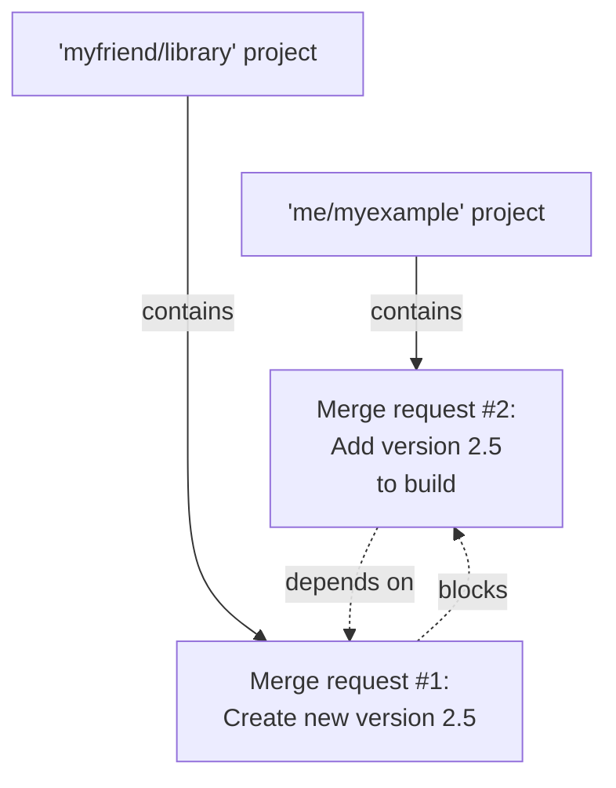
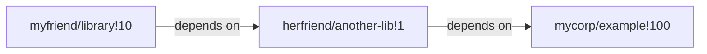



- 티어: Premium, Ultimate
- 제공 서비스: GitLab.com, GitLab Self-Managed, GitLab Dedicated



단일 기능은 여러 머지 리퀘스트에 걸쳐 있을 수 있으며 여러 프로젝트에 분산되어 있을 수 있으며 작업이 병합되는 순서가 중요할 수 있습니다. 머지 리퀘스트 의존성을 설정하면 **머지 리퀘스트 의존성이 병합되어야 함** 병합 확인이 충족될 때까지 종속 머지 리퀘스트는 병합할 수 없습니다.

머지 리퀘스트 의존성은 다음과 같은 도움이 될 수 있습니다:

- 필수 라이브러리의 변경 사항이 라이브러리를 가져오는 프로젝트의 변경 사항보다 먼저 병합되도록 합니다.
- 문서 전용 머지 리퀘스트가 기능 작업이 병합되기 전에 병합되는 것을 방지합니다.
- 권한 매트릭스를 업데이트하는 머지 리퀘스트를 병합하도록 요구하고, 올바른 권한을 아직 가지고 있지 않은 사용자의 작업이 병합되기 전에 합니다.

프로젝트 `me/myexample`가 `myfriend/library`에서 라이브러리를 가져오는 경우, `myfriend/library`가 새 기능을 릴리스할 때 프로젝트를 업데이트해야 합니다. 변경 사항을 `me/myexample`에 병합하기 전에 `myfriend/library`가 새 기능을 추가하면 프로젝트의 기본 브랜치가 손상됩니다. 머지 리퀘스트 의존성은 작업이 너무 빨리 병합되는 것을 방지합니다:

`me/myexample` 머지 리퀘스트를 [초안](drafts.md)으로 표시하고 댓글에서 이유를 설명할 수 있습니다. 이 방법은 수동이며 특히 머지 리퀘스트가 다른 프로젝트의 여러 다른 항목에 의존하는 경우 확장되지 않습니다. 대신 다음을 수행해야 합니다:

- **초안** 또는 **준비** 상태로 개별 머지 리퀘스트의 준비 상태를 추적합니다.
- 머지 리퀘스트 의존성으로 머지 리퀘스트가 병합되는 순서를 적용합니다.

머지 리퀘스트 의존성은 GitLab Premium의 기능이지만 GitLab은 이 제한을 종속 머지 리퀘스트에만 적용합니다:

- GitLab Premium 프로젝트의 머지 리퀘스트는 GitLab Free 프로젝트의 머지 리퀘스트도 포함하여 다른 머지 리퀘스트에 의존할 수 있습니다.
- GitLab Free 프로젝트의 머지 리퀘스트는 다른 머지 리퀘스트에 의존할 수 없습니다.

## 중첩 의존성 {#nested-dependencies}

GitLab 버전 16.7 이상은 간접 중첩 의존성을 지원합니다. 머지 리퀘스트는 최대 10개의 차단기를 가질 수 있으며, 차례로 최대 10개의 다른 머지 리퀘스트를 차단할 수 있습니다. 이 예에서 `myfriend/library!10`은 `herfriend/another-lib!1`에 의존하며, 이는 차례로 `mycorp/example!100`에 의존합니다:

중첩 의존성은 GitLab UI에 표시되지 않지만 UI 지원은 [에픽 5308](https://gitlab.com/groups/gitlab-org/-/epics/5308)에서 제안됩니다.

> [!note]
> 머지 리퀘스트는 자신에게 의존할 수 없습니다(자기 참조). 그러나 순환 의존성을 만들 수 있습니다.

## 머지 리퀘스트의 의존성 보기 {#view-dependencies-for-a-merge-request}

머지 리퀘스트가 다른 항목에 종속된 경우, 머지 리퀘스트 보고서 섹션에는 의존성에 대한 정보가 표시됩니다:

머지 리퀘스트의 의존성 정보를 보려면:

1. 상단 바에서 **검색 또는 이동**을 선택하고 프로젝트를 찾습니다.
1. 왼쪽 사이드바에서 **코드** > **머지 리퀘스트**를 선택하고 머지 리퀘스트를 식별합니다.
1. 머지 리퀘스트 보고서 영역으로 스크롤합니다. 종속 머지 리퀘스트는 설정된 총 의존성 수에 대한 정보를 표시합니다(예: **1개의 머지 리퀘스트가 병합되기를 기다리는 중**).
1. **펼침**을 선택하여 각 의존성의 제목, 마일스톤, 담당자 및 파이프라인 상태를 봅니다.

머지 리퀘스트의 모든 의존성이 병합될 때까지 머지 리퀘스트는 병합할 수 없습니다.

### 닫힌 머지 리퀘스트 {#closed-merge-requests}

닫힌 머지 리퀘스트는 머지 리퀘스트가 계획된 작업을 병합하지 않고도 닫힐 수 있기 때문에 여전히 종속 항목이 병합되는 것을 방지합니다. 머지 리퀘스트가 닫히고 의존성이 더 이상 관련이 없는 경우, 의존성을 제거하여 종속 머지 리퀘스트의 차단을 해제합니다.

## 새로운 종속 머지 리퀘스트 만들기 {#create-a-new-dependent-merge-request}

새로운 머지 리퀘스트를 만들 때 다른 특정 작업이 병합된 후까지 병합되는 것을 방지할 수 있습니다. 이 의존성은 머지 리퀘스트가 다른 프로젝트에 있는 경우에도 작동합니다.

사전 요구 사항:

- 프로젝트에서 머지 리퀘스트를 만들 수 있는 개발자, 유지 관리자 또는 소유자 역할이 있거나 권한이 있어야 합니다.
- 종속 머지 리퀘스트는 Premium 또는 Ultimate 티어의 프로젝트에 있어야 합니다.

새로운 머지 리퀘스트를 만들고 다른 항목에 종속된 것으로 표시하려면:

1. [새 병합 요청을 만듭니다](creating_merge_requests.md).
1. **머지 리퀘스트 의존성**에 이 작업이 병합되기 전에 병합해야 하는 머지 리퀘스트의 참조 또는 전체 URL을 붙여넣습니다. 예를 들어:
   - `!1234` (동일한 프로젝트의 머지 리퀘스트의 경우)
   - `gitlab-org/gitlab!1234`
   - `https://gitlab.com/gitlab-org/gitlab/-/merge_requests/1234`
1. **머지 리퀘스트 생성**을 선택합니다.

## 의존성을 추가하기 위해 머지 리퀘스트 편집 {#edit-a-merge-request-to-add-a-dependency}

기존 머지 리퀘스트를 편집하고 다른 항목에 종속된 것으로 표시할 수 있습니다.

사전 요구 사항:

- 프로젝트에서 머지 리퀘스트를 편집할 수 있는 개발자, 유지 관리자 또는 소유자 역할이 있거나 권한이 있어야 합니다.

다음과 같이 설정합니다.

1. 상단 바에서 **검색 또는 이동**을 선택하고 프로젝트를 찾습니다.
1. 왼쪽 사이드바에서 **코드** > **머지 리퀘스트**를 선택하고 머지 리퀘스트를 식별합니다.
1. **편집**을 선택합니다.
1. **머지 리퀘스트 의존성**에 이 작업이 병합되기 전에 병합해야 하는 머지 리퀘스트의 참조 또는 전체 URL을 붙여넣습니다. 예를 들어:
   - `!1234` (동일한 프로젝트의 머지 리퀘스트의 경우)
   - `gitlab-org/gitlab!1234`
   - `https://gitlab.com/gitlab-org/gitlab/-/merge_requests/1234`

## 머지 리퀘스트에서 의존성 제거 {#remove-a-dependency-from-a-merge-request}

종속 머지 리퀘스트를 편집하고 의존성을 제거할 수 있습니다.

사전 요구 사항:

- 머지 리퀘스트를 편집할 수 있도록 하는 프로젝트의 역할이 있어야 합니다.

1. 상단 바에서 **검색 또는 이동**을 선택하고 프로젝트를 찾습니다.
1. 왼쪽 사이드바에서 **코드** > **머지 리퀘스트**를 선택하고 머지 리퀘스트를 식별합니다.
1. **편집**을 선택합니다.
1. **머지 리퀘스트 의존성**으로 스크롤하고 제거하려는 각 의존성의 참조 옆에 있는 **삭제**를 선택합니다.

   > [!note]
   > 보기 권한이 없는 머지 리퀘스트 의존성은 **1개의 접근 불가능한 머지 리퀘스트**로 표시됩니다. 여전히 의존성을 제거할 수 있습니다.

1. **변경 사항 저장**을 선택합니다.

## 문제 해결 {#troubleshooting}

### 프로젝트 가져오기 또는 내보내기에서 의존성 보존 {#preserve-dependencies-on-project-import-or-export}

프로젝트를 가져오거나 내보낼 때 의존성은 보존되지 않습니다. 자세한 내용은 [이슈 #12549](https://gitlab.com/gitlab-org/gitlab/-/issues/12549)를 참조하세요.
