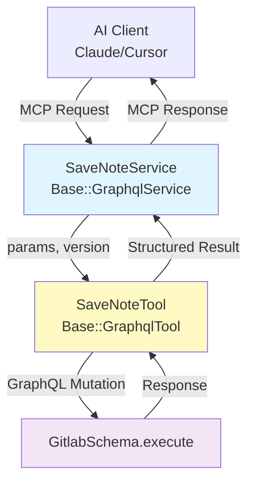

This design introduces a reusable pattern for creating Model Context Protocol
(MCP) tools that leverage the GitLab GraphQL API. The solution provides
a two-layer architecture: a reusable `GraphqlTool` class that handles GraphQL
execution and error processing, and service wrappers extending `GraphqlService`
that handle validation and response formatting.

This pattern enables developers to create new GraphQL-powered MCP tools with
minimal boilerplate while maintaining consistent security and error handling
practices.

The implementation allows AI clients (like Duo agent platform, Claude, Cursor)
to perform complex operations on GitLab resources through GraphQL mutations and
queries, while reusing existing GraphQL schema definitions and
authorization logic.

## Motivation

### Current State

The GitLab MCP implementation uses a route-based architecture with
`route_setting :mcp` that exposes REST API endpoints as MCP tools.
While effective for REST operations, this approach has limitations for GraphQL
integration:

- No built-in pattern for GraphQL-based MCP tools
- Developers must manually wire GraphQL execution
- Inconsistent error handling between REST and GraphQL tools
- No reusable abstraction for common GraphQL operations
- No support for atomic multi-operation requests

### Goals

1. **Reusability**: Create a base class that eliminates boilerplate for GraphQL-based MCP tools
1. **Consistency**: Maintain uniform error handling, and response formatting across all GraphQL tools
1. **Developer Experience**: Enable creation of new GraphQL MCP tools in under 50 lines of code
1. **Security**: Leverage existing GraphQL authorization
1. **Type Safety**: Use static GraphQL schema definitions to prevent runtime errors
1. **Maintainability**: Keep GraphQL operations separate from business logic for easier testing
1. **Atomicity**: Support multiple mutations in a single request

### Non-Goals

- Replacing the existing route-based MCP architecture
- Creating a GraphQL proxy or query builder
- Implementing automatic schema introspection for tool generation
- Supporting GraphQL subscriptions (real-time updates)
- Creating a generic GraphQL client library
- Executing mutations in parallel (GraphQL executes mutations sequentially)

## Solution

Introduce a **two-layer architecture** for GraphQL-based MCP tools:

**Layer 1: GraphQL Tool Classes** (`Mcp::Tools::Base::GraphqlTool`)

- Load GraphQL operations (queries and mutations) from `.graphql` files that are validated against the schema at build time
- Support single mutation or multiple mutations in one request
- Transform input parameters to GraphQL input format
- Execute operations against `GitlabSchema`
- Standardize result processing and error handling

**Layer 2: Service Wrappers** (`Mcp::Tools::*Service < Base::GraphqlService`)

- Extend `GraphqlService` which provides user validation and GraphQL tool execution
- Implement version-specific logic using `Versionable` concern
- Define tool metadata (description, input schema) per version
- Call Layer 1 GraphQL tools via `execute_graphql_tool`
- Format responses for MCP protocol
- Handle service-level errors and logging

### Architecture Diagram



### Data Flow

```plain
1. MCP Client Request
   ↓
2. Service.execute(params)
   ├─ Validate current_user exists
   ├─ Call super (BaseService.execute)
   │  ├─ Validate arguments against input_schema
   │  └─ Call perform(arguments)
   ↓
3. perform method calls execute_graphql_tool(arguments)
   ├─ Build GraphQL query/mutation with static schema
   ├─ Transform params → GraphQL input variables
   ├─ Execute GitlabSchema.execute(graphql_operation, variables)
   └─ Process result (success/errors)
   ↓
4. Format response
   ├─ Success: Response.success(message, payload)
   └─ Error: Response.error(message, reason: ...)
   ↓
5. Return to MCP Client
```

## Design and Implementation Details

### Naming conventions

Name service and tool subclasses after the operation, without a `Graphql` prefix. Only the base
classes `GraphqlService` and `GraphqlTool` keep the prefix. Every subclass already inherits from one
of them, and there is no separate `graphql` folder, so the prefix adds no information.

| Layer           | Pattern              | Example                             |
|-----------------|----------------------|-------------------------------------|
| Service wrapper | `<Operation>Service` | `Mcp::Tools::Labels::SearchService` |
| GraphQL tool    | `<Operation>Tool`    | `Mcp::Tools::Notes::SaveNoteTool` |

The `tool_name` keys registered in `Mcp::Tools::Manager` are a public, append-only contract.
Renaming a Ruby class does not rename its registered tool, so keep the keys unchanged.

### Declare the tool's governance namespace

A GraphQL-backed service must also declare which of its input arguments name the project or
group it acts on, so administrators can enforce tool rules against it. Call the
`container_arguments` macro on the service class, the same way `ListVulnerabilitiesService` and
`Labels::SearchService` do. For the full contract, including the default, the recognized
container kinds, and the `ungovernable!` opt-out, see
[Declare the namespace that governs the tool](_index.md#declare-the-namespace-that-governs-the-tool).

### Layer 1: GraphQL Tool Base Class

**File**: `app/services/mcp/tools/base/graphql_tool.rb`

**Purpose**: Base class for GraphQL-based MCP tools that handles GraphQL
execution, error processing, and versioning.

```ruby
module Mcp
  module Tools
    module Base
      class GraphqlTool
        include Mcp::Tools::Concerns::Versionable

        QUERIES_ROOT = Rails.root.join('app/graphql/queries/mcp').freeze
        IMPORT_PATTERN = %r{^#\s*import "\./(?<path>[^"]+)"$}
        HIDDEN_DENIAL_REASONS = [
          ::Mcp::Tools::Base::Response::Reason::NOT_FOUND,
          ::Mcp::Tools::Base::Response::Reason::UNAUTHORIZED
        ].freeze

        def self.load_graphql(relative_path)
          query = read_graphql_file(relative_path)
          directory = File.dirname(relative_path)
          fragments = query.scan(IMPORT_PATTERN).flatten.map do |path|
            read_graphql_file(File.join(directory, path))
          end

          [query, *fragments].join("\n").freeze
        end

        def self.read_graphql_file(relative_path)
          File.read(QUERIES_ROOT.join(relative_path))
        end

        attr_reader :current_user, :params, :access_token

        def initialize(current_user:, params:, access_token:, version: nil)
          @current_user = current_user
          @params = params
          @access_token = access_token
          initialize_version(version)
        end

        # Override in subclasses or use version metadata
        def graphql_operation
          raise NotImplementedError unless self.class.version_metadata(version)[:graphql_operation]

          self.class.version_metadata(version)[:graphql_operation]
        end

        def operation_name
          self.class.version_metadata(version)[:operation_name] ||
          raise(NotImplementedError, "operation_name must be defined")
        end

        # Can be overridden with version-specific methods
        def build_variables
          raise NotImplementedError, "build_variables must be implemented"
        end

        def execute
          denied_earlier = ::Current.granular_denied_permissions
          ::Current.granular_denied_permissions = nil

          result = GitlabSchema.execute(
            graphql_operation_for_version,
            variables: build_variables_for_version,
            context: execution_context
          )
          denied = Array(::Current.granular_denied_permissions)

          response = process_result(result)
          return granular_denied_error(denied) if denied.any? && hides_denial?(response)

          response
        ensure
          ::Current.add_granular_denied_permissions(denied_earlier)
        end

        private

        def hides_denial?(response)
          ::Mcp::Tools::Base::Response.error?(response) &&
            HIDDEN_DENIAL_REASONS.include?(response[:reason])
        end

        # GraphQL turns a granular token denial on a query into null data, which tools report as not found.
        # Denials are recorded only after the boundary visibility check, so hidden projects and groups stay hidden.
        def granular_denied_error(permissions)
          ::Mcp::Tools::Base::Response.error(
            ::Authz::Tokens::AuthorizeGranularScopesService.access_denied_message(
              token: access_token, permissions: permissions
            ),
            reason: ::Mcp::Tools::Base::Response::Reason::UNAUTHORIZED
          )
        end

        def execution_context
          {
            current_user: current_user,
            access_token: access_token,
            is_sessionless_user: false,
            mcp_tool: mcp_tool_identifier
          }
        end

        def process_result(result)
          if result['errors']
            error_messages = extract_error_messages(result['errors'])
            return ::Mcp::Tools::Base::Response.error(error_messages.join(', '))
          end

          operation_data = result.dig('data', operation_name)

          if operation_data.nil?
            return ::Mcp::Tools::Base::Response.error(
              "Operation returned no data", reason: ::Mcp::Tools::Base::Response::Reason::NOT_FOUND
            )
          end

          operation_errors = operation_data['errors']
          if operation_errors&.any?
            error_messages = extract_error_messages(operation_errors)
            return ::Mcp::Tools::Base::Response.error(
              error_messages.join(', '), reason: ::Mcp::Tools::Base::Response::Reason::BAD_REQUEST
            )
          end

          formatted_content = [{ type: 'text', text: Gitlab::Json.dump(operation_data) }]
          ::Mcp::Tools::Base::Response.success(formatted_content, operation_data)
        end

        def extract_error_messages(errors)
          errors.map do |error|
            if error.is_a?(String)
              error
            elsif error.is_a?(Hash)
              error['message'] || error.to_s
            else
              error.to_s
            end
          end
        end
      end
    end
  end
end
```

**Key Design Decisions**:

- **File-backed operations**: GraphQL operations live in `.graphql` files that are validated against the schema at build time
- **MCP Response format**: Returns `Mcp::Tools::Base::Response` objects (success or error)
- **Flexible operation support**: Supports both mutations and queries
- **Context isolation**: Each tool instance is independent (no shared state)
- **Framework agnostic**: Works with any GraphQL operation type
- **Error extraction**: Handles both GraphQL-level and operation-level errors

### Store GraphQL operations in `.graphql` files

Store each tool's GraphQL operation in a `.graphql` file under `app/graphql/queries/mcp/`, and load it with `GraphqlTool.load_graphql`.
Do not embed the operation as an inline string or HEREDOC.

Files in this directory are validated against `GitlabSchema` at build time by `spec/graphql/all_queries_spec.rb`, so an operation that drifts from the schema fails CI.
An inline operation skips this check.

Place the file under a subdirectory that mirrors the tool's domain, and name it with a `.query.graphql` or `.mutation.graphql` suffix:

```plaintext
app/graphql/queries/mcp/
  work_items/create_note.mutation.graphql
  work_items/get_work_item_types.query.graphql
  labels/search.query.graphql
```

Use a verb-first name for a query operation to match the operations already in `app/graphql/queries`, for example `getWorkItemTypes` rather than `WorkItemTypes`.
Mutations already use a verb-first name, such as `createNote`.

Start each file with a `# @feature_category:` comment.
The frontend `graphql_require_feature_category` lint rule requires one on every GraphQL operation, and the lint job fails without it:

```graphql
# @feature_category: mcp_server
query getWorkItemTypes($fullPath: ID!) {
  # ...
}
```

Load the file in `register_version` with the direct `load_graphql(...)` form, not a lambda.
`graphql_operation_for_version` calls a lambda on every request, so `-> { load_graphql(...) }` rereads the file each time:

```ruby
register_version VERSIONS[:v0_1_0], {
  operation_name: 'createNote',
  graphql_operation: load_graphql('work_items/create_note.mutation.graphql')
}
```

The `Mcp/UseGraphqlQueryFile` RuboCop rule flags an inline string or HEREDOC passed as `graphql_operation:` and points to `load_graphql`.

#### Add fields that exist only in EE

Do not copy the query into `ee/` to add EE-only fields.
Spread a fragment in the CE query and import it from a file in the same directory:

```graphql
# @feature_category: mcp_server
#import "./merge_request_edition_fields.fragment.graphql"

query getMergeRequest($fullPath: ID!, $iid: String!) {
  project(fullPath: $fullPath) {
    mergeRequest(iid: $iid) {
      id
      ...MergeRequestEditionFields
    }
  }
}
```

Give the CE fragment a field the query already selects, because a fragment cannot be empty.
Put the EE fields in a fragment file with the same name under `ee/app/graphql/queries/mcp/`.
`load_graphql` reads the EE file in place of the CE file, so keep the direct form in `register_version`.
For an example, see `get_merge_request.query.graphql`.

`all_queries_spec.rb` resolves the import to the CE fragment.
A spec that runs the tool in EE is the only check of the EE fragment against the schema.

Use a lambda (`graphql_operation: -> { build_query }`) only for an operation built in Ruby by a class that EE prepends, such as `WorkItemsQueryBuilder`.

### Layer 2: GraphqlService Base Class

**File**: `app/services/mcp/tools/base/graphql_service.rb`

**Purpose**: Provides a specialized base service for GraphQL-based MCP tools with user validation, versioning support, and GraphQL tool execution.

```ruby
module Mcp
  module Tools
    module Base
      class GraphqlService < BaseService
        include Mcp::Tools::Concerns::Versionable
        include Mcp::Tools::Concerns::GranularTokenAuthorization
        extend Gitlab::Utils::Override

        def initialize(name:, version: nil)
          super(name: name)
          initialize_version(version)
        end

        override :set_cred
        def set_cred(current_user: nil, access_token: nil)
          @current_user = current_user
          @access_token = access_token
        end

        override :execute
        def execute(request: nil, params: nil)
          unless current_user.present?
            return Response.error(
              "#{self.class.name}: current_user is not set", reason: Response::Reason::UNAUTHORIZED
            )
          end

          super
        end

        protected

        # Subclasses should override this to return their GraphQL tool class
        def graphql_tool_class
          raise NotImplementedError, "#{self.class.name}#graphql_tool_class must be implemented"
        end

        # Default implementation - can be overridden in subclasses
        def perform_default(_arguments = {})
            raise NoMethodError, "No implementation found for version #{version}"
        end

        private

        def execute_graphql_tool(arguments)
          tool = graphql_tool_class.new(
            current_user: current_user,
            params: arguments,
            version: version,
            access_token: access_token
          )

          tool.execute
        end
      end
    end
  end
end
```

**Key Features**:

- **Extends BaseService**: Inherits MCP protocol support and validation
- **Versionable**: Supports multiple versions with `register_version`
- **User validation**: Ensures `current_user` is set before execution
- **GraphQL tool integration**: Provides `execute_graphql_tool` helper to instantiate and execute GraphQL tools
- **Access token**: Passes the caller's access token to the GraphQL tool, so granular token checks apply
- **Template pattern**: Subclasses define `graphql_tool_class` and version-specific `perform_X_Y_Z` methods

### Versionable Concern Enhancements

**File**: `app/services/mcp/tools/concerns/versionable.rb`

**GraphQL-Specific Methods:**

```ruby
# Retrieve GraphQL operation from version metadata
def graphql_operation
  version_metadata.fetch(:graphql_operation) do
    raise NotImplementedError, "GraphQL operation not defined for version #{version}"
  end
end

# Retrieve operation name from version metadata
def operation_name
  version_metadata.fetch(:operation_name) do
    raise NotImplementedError, "operation_name must be defined"
  end
end

protected

# Get operation with fallback to method override
def graphql_operation_for_version
  version_metadata[:graphql_operation] || graphql_operation
end

# Call version-specific build_variables method or fallback
def build_variables_for_version
  method_name = "build_variables_#{version_method_suffix}"
  respond_to?(method_name, true) ? send(method_name) : build_variables
end
```

### Service Wrapper Pattern

**File**: `app/services/mcp/tools/notes/save_note_service.rb`

**Purpose**: Provides input validation, MCP protocol compliance, and version
management. Authorization is delegated to GraphQL layer.

This `input_schema` below omits optional properties such as `minLength` and `enum`; add them as needed.

```ruby
module Mcp
  module Tools
    module Notes
      class SaveNoteService < Base::GraphqlService
        register_version '0.1.0', {
          toolset: :core,
          description: 'Add a comment to a GitLab merge request or work item, or reply to an existing ' \
            'discussion thread',
          annotations: {
            readOnlyHint: false,
            destructiveHint: false
          },
          input_schema: {
            type: 'object',
            properties: {
              url: {
                type: 'string',
                description: 'GitLab URL of the merge request or work item'
              },
              project_id: {
                type: 'string',
                description: 'ID or path of the project. Required with merge_request_iid or work_item_iid'
              },
              work_item_iid: {
                type: 'integer',
                description: 'Internal ID of the work item. Mutually exclusive with merge_request_iid'
              },
              body: {
                type: 'string',
                description: 'Content of the note/comment (max ' \
                  "#{Concerns::Constants::MARKDOWN_TEXT_MAX_LENGTH} characters)",
                maxLength: Concerns::Constants::MARKDOWN_TEXT_MAX_LENGTH
              }
            },
            required: ['body']
          }
        }

        protected

        # Specify which GraphQL tool class to use
        def graphql_tool_class
          Mcp::Tools::Notes::SaveNoteTool
        end

        # Version 0.1.0 implementation
        def perform_v0_1_0(arguments)
          execute_graphql_tool(arguments)
        end

        # Fallback to 0.1.0 behavior for any unimplemented versions
        override :perform_default
        def perform_default(arguments = {})
          perform_v0_1_0(arguments)
        end
      end
    end
  end
end
```

**Key Design Decisions**:

- **Inheritance from GraphqlService**: Provides user validation and GraphQL tool execution infrastructure
- **Version registration**: Uses register_version to define tool metadata per version
- **Automatic `additionalProperties: false`**: The shared tool abstraction rejects unrecognized arguments by default, so you do not add `additionalProperties` to `input_schema`. To accept arbitrary arguments, set `additionalProperties: true`. Schemas that use `oneOf`, `anyOf`, `allOf`, or `$ref` keep their own behavior.
- **Version-specific methods**: Implement `perform_v0_1_0` for the tool's registered version
- **GraphQL tool class**: Override `graphql_tool_class` to specify which tool to use
- **Simplified perform methods**: Just call `execute_graphql_tool(arguments)` which handles tool instantiation and execution
- **Response handling**: Tool execution returns MCP Response directly

### Mutation Tool Example

**File**: `app/services/mcp/tools/notes/save_note_tool.rb`

**Use Case**: Create a note (comment) on a merge request or work item.

Each version loads its operation from a `.graphql` file.
For more information, see [Store GraphQL operations in `.graphql` files](#store-graphql-operations-in-graphql-files).

```graphql
# app/graphql/queries/mcp/notes/create_note.mutation.graphql
# @feature_category: mcp_server
mutation createNote($input: CreateNoteInput!) {
  createNote(input: $input) {
    note {
      id
      body
      internal
      createdAt
      updatedAt
      url
      author {
        id
        name
        username
        avatarUrl
        webUrl
      }
      discussion {
        id
      }
    }
    errors
  }
}
```

`SaveNoteTool` inherits from `Base::GraphqlTool` directly and resolves the target noteable from
either a URL, a project and merge request IID pair, or a project/group and work item IID pair.
The tool class registers only the GraphQL operation; annotations such as `readOnlyHint` are declared in
`SaveNoteService`'s `register_version` (see the [Service Wrapper Pattern](#service-wrapper-pattern) section above):

```ruby
module Mcp
  module Tools
    module Notes
      class SaveNoteTool < Mcp::Tools::Base::GraphqlTool
        include Mcp::Tools::Concerns::ContentValidation
        include Mcp::Tools::Concerns::ResourceFinder
        include Mcp::Tools::Concerns::UrlParser
        include Mcp::Tools::Concerns::MergeRequestResolution

        register_version VERSIONS[:v0_1_0], {
          operation_name: 'createNote',
          graphql_operation: load_graphql('notes/create_note.mutation.graphql')
        }

        def build_variables
          validate_no_quick_actions!(params[:body], field_name: 'note body')

          { input: build_note_input }
        end

        private

        def build_note_input
          {
            noteableId: resolve_noteable_id,
            body: params[:body],
            internal: params[:internal],
            discussionId: params[:discussion_id]
          }.compact
        end

        def resolve_noteable_id
          return resolve_noteable_from_url(params[:url]) if params[:url]

          # ... dispatch on merge_request_iid vs. work_item_iid
        end
      end
    end
  end
end
```

#### Later versions

Do not register a later version until MCP clients can select one.
For more information, see [Modifying an existing tool](_index.md#modifying-an-existing-tool).

### Composite Tool Example

Composite tools combine multiple related operations into a single, cohesive MCP tool.
Instead of creating separate tools for each different resource, a composite
tool provides a unified interface with operation-specific parameters.

**Important Limitation**: You can only perform one mutation operation per tool
invocation.

**Benefits of composite tools**:

- **Reduced tool proliferation**: Fewer tools for AI clients to discover and manage
- **Consistent interface**: Related operations share common parameters
- **Better discoverability**: Logical grouping makes it easier for users to find related functionality
- **Simplified maintenance**: Shared validation and error handling logic

**Example use cases**:

- **Create work item notes (mutation)** - A single tool that handles creating notes (comments) on work items, with flexible identification methods (URL, project/group ID + IID)
- **Get work item notes (query)** - A single tool that handles retrieving notes (comments) on work items, with flexible identification methods (URL, project/group ID + IID)

**Implemented issues**:

- [#581890](https://gitlab.com/gitlab-org/gitlab/-/issues/581890) - GraphQL-based MCP mutation tool for creating notes (comments) on work items
- [#581892](https://gitlab.com/gitlab-org/gitlab/-/issues/581892) - GraphQL-based MCP query tool for retrieving notes (comments) from work items

### Security Model

**Authorization Flow**:

1. MCP client calls `service.execute(request:, params:)`
1. `GraphqlService.execute` validates current_user presence
1. `BaseService.execute` calls `perform(arguments)`
1. `perform` method calls `execute_graphql_tool(arguments)`
1. GraphQL tool executes mutation/query
1. GraphQL enforces authorization via `authorize` directive in mutations/resolvers
1. For a fine-grained token, GraphQL also checks the `authorize_granular_token`
   directive on each type and mutation the operation reaches

**GraphQL Context**:

- `current_user`: Set on every GraphQL execution
- `access_token`: The token that called the MCP endpoint, used for granular token checks
- `is_sessionless_user: false`: Marks as API/MCP request
- `mcp_tool`: The tool's `mcp_tool_identifier`, `nil` unless the tool overrides it. GraphQL code
  can read it to change behavior for one tool, as `CreateWorkItemTool` does.
- Context is consistent across all mutations in a multi-mutation request

For details on how `ResourceFinder` folds authorization into the DB lookup to prevent
resource enumeration, see
[Resource identification](_index.md#tool-naming-and-consolidation-conventions).

#### Fine-grained token checks

Fine-grained tokens can call the MCP endpoint if they grant the `execute_mcp_tool` permission at
the user level. This includes fine-grained personal access tokens, and fine-grained OAuth tokens
when the `granular_oauth_tokens` feature flag is enabled. Each tool then checks its own permissions.
In a top-level group that enforces fine-grained tokens, legacy personal access tokens go through
the same checks and are denied.

A GraphQL tool runs its operation with the caller's token, so the token's permissions limit what
the tool can read and change.

- Every type and mutation that the tool's operation reaches needs an `authorize_granular_token`
  directive. GraphQL denies a fine-grained token on a type without one. The tool then works for
  other tokens but returns no data or an error for fine-grained tokens. Types still missing a
  directive are listed in `config/authz/graphql/authorization_todo.txt`. If your operation reaches
  one, add the directive in a separate merge request first. A new directive changes what every
  fine-grained token can reach in the GraphQL API, so it needs its own authorization review.
  For more information, see the
  [GraphQL implementation guide](../../permissions/granular_access/graphql_implementation_guide.md).
- What the agent gets for a denied token depends on where GraphQL denies it:
  - When a directive denies a query's root type, GraphQL returns null data, and
    `GraphqlTool#execute` returns an `UNAUTHORIZED` error that names the missing permissions.
  - When a query's root type has no directive, the tool returns `Operation returned no data`.
  - When a mutation's directive denies the token, the tool returns the GraphQL error, which names
    the missing permissions. A mutation without a directive returns a generic access error instead.
  - Below the root, a denied object is null, or dropped from a list, and the tool still succeeds.
- Some services do part of their work outside GraphQL, for example by calling a Rails service
  directly. Before that work, check the token with
  `authorize_granular_token!(resource, permissions, not_found_message:)` from
  `Mcp::Tools::Concerns::GranularTokenAuthorization`. Use the permission that the matching REST
  endpoint or GraphQL mutation checks. For examples, see `SaveMergeRequestReviewService` and
  `SavePipelineService`.

### Error Handling Strategy

**Three Error Levels**:

1. **Service-level errors** (GraphqlService):
   - Missing `current_user`
   - Returns: `Response.error(message, reason: Response::Reason::UNAUTHORIZED)`
1. **GraphQL-level errors** (syntax, validation):
   - Invalid GraphQL syntax
   - Type mismatches
   - Returns: `Response.error(joined_messages)`, which defaults to the `error` reason because this
     branch mixes denials with query and argument validation failures
1. **Mutation-level errors** (business logic):
   - Validation failures (e.g., empty title)
   - State conflicts
   - Returns: `Response.error(joined_messages, reason: Response::Reason::BAD_REQUEST)`

**Error Propagation**:

```plain
GitlabSchema.execute → GraphqlTool.process_result →
GraphqlService.execute_graphql_tool → Response.error → MCP Client
```

**Multiple Mutation Error Handling**:

- **Failure**: If any mutation fails, the entire operation is marked as failed
- **Error aggregation**: Errors from all mutations are collected and returned together
- **Example**: If `createIssue` succeeds but `updateIssue` fails:
  - Overall result: `Response.error(...)`
  - Errors include: `"updateIssue: Title can't be blank"`

### Creating New Tools - Step-by-Step Guide

**Step 1: Add the GraphQL operation file**

Add the operation under `app/graphql/queries/mcp/`, in a subdirectory that mirrors the tool's domain.
For more information, see [Store GraphQL operations in `.graphql` files](#store-graphql-operations-in-graphql-files).

```graphql
# app/graphql/queries/mcp/your_domain/your.mutation.graphql
# @feature_category: mcp_server
mutation yourMutation($input: YourInput!) {
  yourMutation(input: $input) {
    result {
      id
      title
    }
    errors
  }
}
```

**Step 2: Define the GraphQL tool class**

```ruby
# app/services/mcp/tools/your_domain/your_tool.rb
module Mcp
  module Tools
    module YourDomain
      class YourTool < Base::GraphqlTool
        # Load the operation from its .graphql file
        register_version '0.1.0', {
          operation_name: 'yourMutation',
          graphql_operation: load_graphql('your_domain/your.mutation.graphql')
        }

        # Implement variable building
        def build_variables
          {
            input: {
              projectPath: params[:project_path],
              title: params[:title]
            }.compact
          }
        end
      end
    end
  end
end
```

**Step 3: Create the service wrapper**

```ruby
# app/services/mcp/tools/your_domain/your_service.rb
module Mcp
  module Tools
    module YourDomain
      class YourService < Base::GraphqlService
        # Register version with metadata
        register_version '0.1.0', {
          description: 'Description of what this tool does',
          annotations: { readOnlyHint: false },
          input_schema: {
            type: 'object',
            properties: {
              project_path: { type: 'string', description: '...' },
              title: { type: 'string', description: '...' }
            },
            required: ['project_path', 'title']
          }
        }

        protected

        # Specify the GraphQL tool class to use
        def graphql_tool_class
          Mcp::Tools::YourDomain::YourTool
        end

        # Version 0.1.0 implementation
        def perform_v0_1_0(arguments)
          execute_graphql_tool(arguments)
        end

        # Fallback to 0.1.0 behavior for any unimplemented versions
        override :perform_default
        def perform_default(arguments = {})
          perform_v0_1_0(arguments)
        end
      end
    end
  end
end
```

**Step 4: Register the tool in the manager**

GraphQL tools are registered separately from custom tools in Mcp::Tools::Manager:

```ruby
GRAPHQL_TOOLS = {
  'your_tool_name' => ::Mcp::Tools::YourDomain::YourService
}.freeze
```

**Step 5: Add tests**

- Unit tests for GraphQL tool. `GraphqlTool#initialize` requires the `access_token:` keyword, so
  construct the tool with `described_class.new(current_user:, params:, version:, access_token: nil)`.
  `spec/services/mcp/tools/base/graphql_tool_spec.rb` already checks that the token reaches the
  GraphQL context. If your tool overrides `execute`, add an example that checks it for your tool,
  as in `spec/services/mcp/tools/labels/search_tool_spec.rb`.
- Integration tests for service
- A context for the tool in `spec/requests/api/mcp/granular_token_authorization_spec.rb`.
  It checks that a fine-grained token is denied without the tool's permissions and allowed with
  them, so it also catches a missing directive.
- For a tool that returns more than one record, add an N+1 test with the
  `'an MCP tool that avoids N+1 queries'` shared example.
  Copy the setup from `spec/services/mcp/tools/merge_requests/list_merge_requests_service_spec.rb`:
  create one record before the control call, and put each added record in its own new subgroup and project.
  If the extra queries come from existing GraphQL code, find or open an issue, set `threshold:` to the exact increase,
  and link the issue in a `# TODO:` comment above the `it_behaves_like` line.
  Measure in EE and with `FOSS_ONLY=1`.
  If the counts differ, gate the CE example with `context 'when CE edition', unless: Gitlab.ee?`
  and put the EE example under `ee/spec/services/ee/mcp/tools/`.
  When both reach zero, delete the EE example and unwrap the CE one.
- Update test in `ee/spec/services/ee/mcp/tools/manager_spec.rb`
- Update tests in `spec/requests/api/mcp/handlers/list_tools_spec.rb` and `ee/spec/requests/api/mcp/handlers/list_tools_spec.rb`

## Alternative Solutions

### Alternative 1: Direct GraphQL Execution in Services

**Approach**: Execute GraphQL directly in service classes without abstraction layer.

```ruby
class CreateWorkItemNoteService < Base::GraphqlService
  def perform_v0_1_0(params)
    result = GitlabSchema.execute(MUTATION, variables: params, context: {...})
    # Handle result inline
  end
end
```

**Pros**:

- Fewer abstraction layers
- All logic in one file

**Cons**:

- **Code duplication**: Error handling repeated in every service
- **No reusability**: GraphQL operations can't be used elsewhere
- **Testing complexity**: Must test GraphQL execution in every service test
- **Inconsistent patterns**: Each developer implements differently

**Decision**: Rejected due to maintainability concerns.

### Alternative 2: GraphQL Proxy Service

**Approach**: Generic service that accepts arbitrary GraphQL queries from MCP clients.

```ruby
class ProxyService < Base::GraphqlService
  def perform_v0_1_0(params)
    query = params[:query]
    GitlabSchema.execute(query, variables: params[:variables], context: {...})
  end
end
```

**Pros**:

- Maximum flexibility for clients
- No need to create new tools

**Cons**:

- **Security risk**: Clients could execute unauthorized queries
- **No schema validation**: Can't enforce required fields
- **Performance concerns**: No query complexity limits
- **No discoverability**: MCP clients can't know what operations are available

**Decision**: Rejected due to security and authorization concerns.

### Alternative 3: Auto-Generated Tools from GraphQL Schema

**Approach**: Automatically generate MCP tools by introspecting GraphQL schema.

**Pros**:

- No manual tool creation
- Always in sync with schema

**Cons**:

- **Generic descriptions**: Auto-generated docs less useful than hand-written
- **Over-exposure**: Would expose all mutations, not just approved ones
- **Parameter complexity**: Hard to simplify complex nested inputs
- **Maintenance burden**: Schema changes break all tools simultaneously

**Decision**: We will consider this in the next iteration.
Manual tool creation provides better control and documentation.

## Performance Considerations

**Query Complexity**: GraphQL tools inherit GitLab query complexity limits (200 by default).

**Caching**: GraphQL resolver-level caching applies automatically.

**Batch Loading**: Batch loading and lookahead preloads do not cover everything.
Authorizing each returned object can still run queries for each project or group the records belong to,
so test list tools for N+1 queries.

**Monitoring**: All GraphQL executions logged via existing `GraphqlLogger`.

## Success Metrics

- **Adoption**: Number of GraphQL-based MCP tools created
- **Developer velocity**: Time to create new tool
- **Code reuse**: Lines of code saved vs. alternative approaches

## Future Enhancements

- **Multiple Mutations**: Support multiple mutation GraphQL calls. This can be implemented by calling different tools from the service class and aggregating the responses
- **Dependent mutations**: Execute multiple GraphQL calls to support dependent mutations
- **Auto-Generated Tools**: Automatically generate MCP tools by introspecting GraphQL schema
