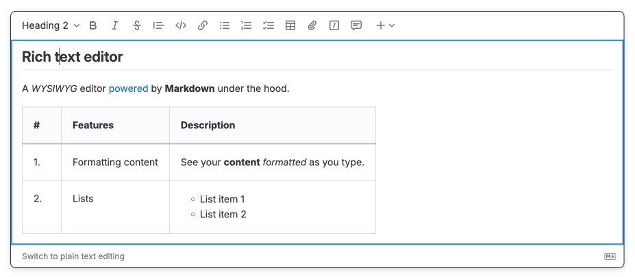
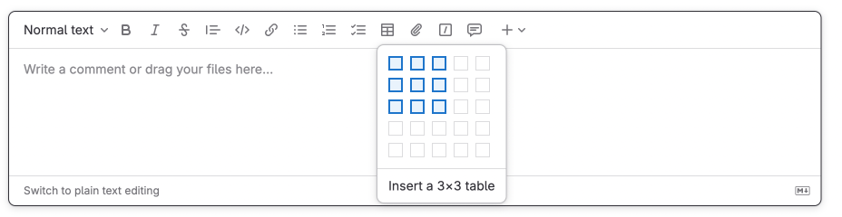
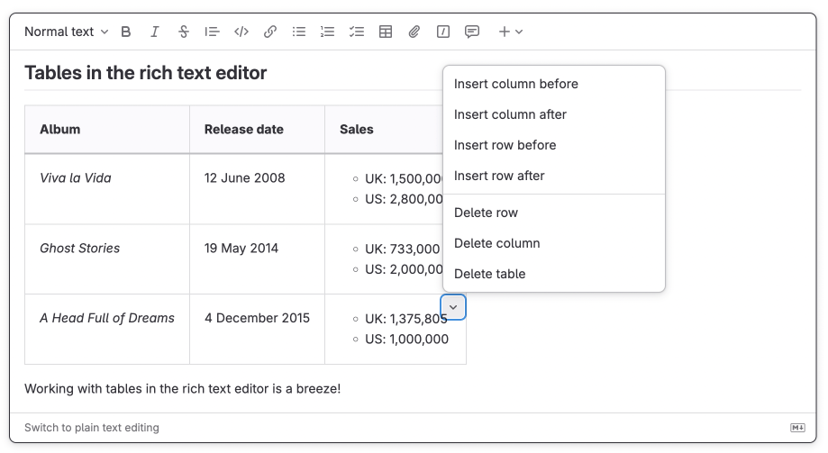
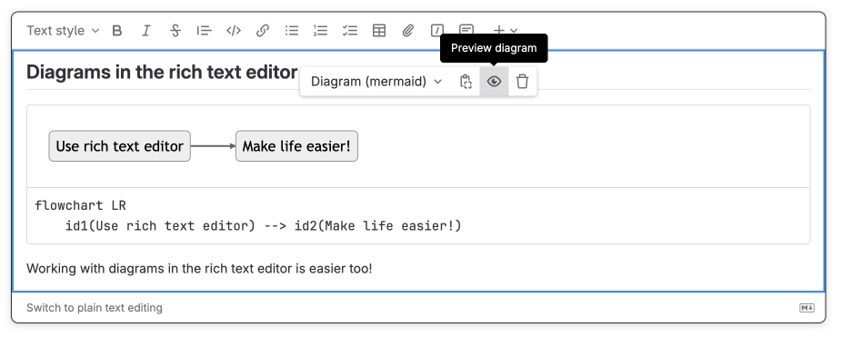



- Tier: Free, Premium, Ultimate
- Offering: GitLab.com, GitLab Self-Managed, GitLab Dedicated





- Rich text editor [set to default editor for new users](https://gitlab.com/gitlab-org/gitlab/-/issues/536611) in GitLab 18.2.



The rich text editor is the default text editor for new users in GitLab.

You can use the rich text editor in:

- [Wikis](project/wiki/_index.md)
- Issues
- Epics
- Merge requests
- [Designs](project/issues/design_management.md)

Features of the editor include:

- Format text, including as bold, italics, block quotes, headings, and inline code.
- Format ordered lists, unordered lists, and checklists.
- Insert links, attachments, images, video, and audio.
- Create and edit a table structure.
- Insert and format code blocks with syntax highlighting.
- Preview Mermaid, PlantUML, and Kroki diagrams in real time.

To track work on adding the rich text editor to more places across GitLab, see
[epic 7098](https://gitlab.com/groups/gitlab-org/-/epics/7098).

## Switch to the rich text editor

Use the rich text editor to edit descriptions, wiki pages, add comments.

To switch to the rich text editor: In a text box, in the lower-left corner, select
**Switch to rich text editing**.

## Switch to the plain text editor

If you want to enter Markdown source in the text box, return to using the plain text editor.

To switch to the plain text editor: In a text box, in the lower-left corner, select
**Switch to plain text editing**.



## Compatibility with GitLab Flavored Markdown

The rich text editor is fully compatible with [GitLab Flavored Markdown](markdown.md).
It means that you can switch between plain text and rich text modes without losing any data.

### Input rules

Rich text editor also supports input rules that let you work with rich content as if you were
typing Markdown.

Supported input rules:

<!-- markdownlint-disable MD055 MD056 -->

| Input rule syntax                                         | Content inserted     |
| --------------------------------------------------------- | -------------------- |
| `# Heading 1` through `###### Heading 6`                  | Headings 1 through 6 |
| `**bold**` or `__bold__`                                  | Bold text            |
| `_italics_` or `*italics*`                                | Italicized text      |
| `~~strike~~`                                              | Strikethrough        |
| `[link](https://example.com)`                             | Hyperlink            |
| `code`                                                    | Inline code          |
| ` ```rb ` + <kbd>Enter</kbd> <br> ` ```js ` + <kbd>Enter</kbd> | Code block      |
| `* List item`, or<br> `- List item`, or<br> `+ List item` | Unordered list       |
| `1. List item`                                            | Numbered list        |
| `<details>`                                               | Collapsible section  |
{.sortable}

<!-- markdownlint-enable MD055 MD056 -->

## Tables

Unlike in raw Markdown, you can use the rich text editor to insert block content paragraphs,
list items, diagrams (or even another table!) in table cells.

### Insert a table

To insert a table:

1. Select **Insert table** .
1. From the dropdown list, select the dimensions of the new table.



### Edit a table

Inside a table cell, you can use a menu to insert or delete rows or columns.

To open the menu: In the upper-right corner of a cell, select the chevron .



### Operations on multiple cells

Select multiple cells and merge or split them.

To merge selected cells into one:

1. Select multiple cells - select one and drag your cursor.
1. In the upper-right corner of a cell, select the chevron  > **Merge N cells**.

To split merged cells: In the upper-right corner of a cell, select the chevron  > **Split cell**.

### Paste into a table cell



- Table menu paste actions [introduced](https://gitlab.com/gitlab-org/gitlab/-/work_items/627112) in GitLab 19.4.
- Keyboard shortcut for pasting into a table cell [introduced](https://gitlab.com/gitlab-org/gitlab/-/work_items/627699) in GitLab 19.4.



When you press <kbd>Control</kbd>+<kbd>V</kbd> (or <kbd>Command</kbd>+<kbd>V</kbd> on macOS),
GitLab merges the copied cells into the table by default.

To choose how the content is pasted:

1. In the upper-right corner of the target cell, select the chevron
   .
1. Select one of these options:
   - **Paste into cell**: Inserts the copied content at the cursor. A copied table becomes a
     table nested inside the cell.
   - **Paste and merge into table**: Distributes the copied cells across the table (default behavior).

Each option also shows its keyboard shortcut next to its label.
To paste a copied table as a nested table without opening the menu, place your cursor in a table cell.
Then press <kbd>Control</kbd>+<kbd>Alt</kbd>+<kbd>V</kbd>
(or <kbd>Command</kbd>+<kbd>Option</kbd>+<kbd>V</kbd> on macOS).

The first time you use either option, your browser might ask for permission to read your
clipboard.

> [!note]
> On GitLab Self-Managed, the paste options and the keyboard shortcut are not available if your
> instance is served over plain HTTP. These features require browser access to the clipboard, and
> browsers allow that access only on pages served over HTTPS or from `localhost`.

## Insert diagrams

Insert [Mermaid](https://mermaidjs.github.io/) and [PlantUML](https://plantuml.com/) diagrams and
preview them live as you type the diagram code.

To insert a diagram:

1. In the editor toolbar, select  () >
    or .
1. Enter the code for your diagram. The diagram preview appears in the text box.



## Embed external content



- Offering: GitLab.com, GitLab Self-Managed
- Status: Experiment





- [Introduced](https://gitlab.com/gitlab-org/gitlab/-/merge_requests/231412) in GitLab 19.0 [with a feature flag](../administration/feature_flags/_index.md) named `allow_iframes_in_markdown`. Disabled by default.
- Inserting embedded content from the editor toolbar [introduced](https://gitlab.com/gitlab-org/gitlab/-/issues/282443) in GitLab 19.6.



> [!flag]
> The availability of this feature is controlled by a feature flag.
> For more information, see the history.
> This feature is available for testing, but not ready for production use.

Insert content, like a YouTube video or a Figma design, from an
[embed provider](markdown.md#embedded-content) that your administrator allows.

### From the editor toolbar

To insert embedded content from the editor toolbar:

1. In the editor toolbar, select  () >
   .
1. Complete the fields.  must be from an allowed embed provider.
1. Select .

### From a link

To embed content, paste the image Markdown or the `<iframe>` embed code from the provider.

### Edit embedded content

To resize embedded content, select it, then drag one of its corners.

To change the URL or title of embedded content:

1. Select the embedded content.
1. Select  ().
1. Edit the  or .
1. Select .

## Related topics

- [Set the default text editor](profile/preferences.md#set-the-default-text-editor)
- [Keyboard shortcuts](shortcuts.md#rich-text-editor) for rich text editor
- [GitLab Flavored Markdown](markdown.md)
